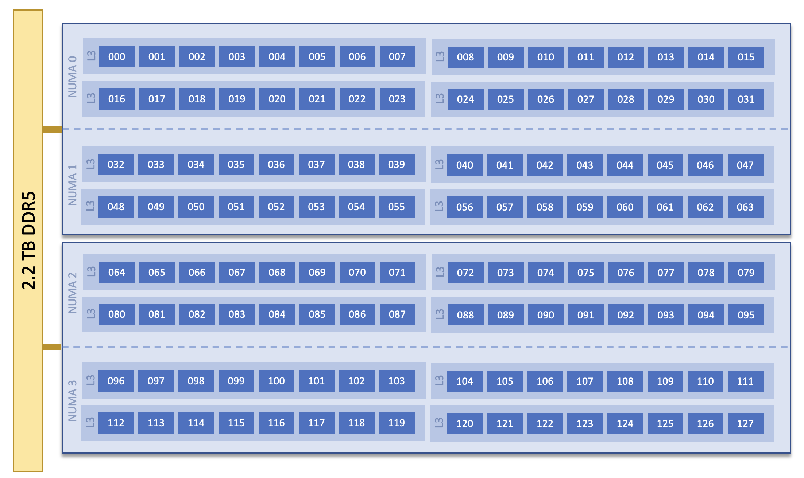

# Module 3 -- Shared-Memory Parallelism with OpenMP

> **Time:** 10:20 to 11:10 AM CST · 50 min total · ~15 min lecture · ~35 min hands-on

## Learning Objectives

By the end of this module, you will be able to:

- Understand what threads are and how that relates to OpenMP
- Add OpenMP directives to parallelize a serial C program
- Control the number of threads and measure speedup
- Identify and fix race conditions in shared-memory code
- Check an agent's script against results you measured yourself

---


CPUs stopped getting "faster" a while ago i.e. the number of instructions it
can execute per second has plateaud. For
many years, programs got faster automatically as CPU clock speeds increased.
Today, clock speeds improve much more slowly, and most CPUs tend to stay
between 2-4 GHz. 

So how can we get more work done if the CPUs can't get faster. We do that by performing tasks in
parallel. CPUs have gotten better by increasing the number of "cores" they have, where each core can
independently execute instructions. CPUs that run on servers or HPC nodes can have dozens of cores,
which if you can program it right can accomplish a large amount of tasks in parallel. This is useful
in the HPC world where you can break up a problem into smaller tasks that you can divide up among
the cores and then (if needed) combine the individual results into a final answer.

You can see below for example a simplified block diagram showing 2 64-core AMD EPYC 9534 CPUs, from
the Riker cluster at Oak Ridge National Laboratory. You can see that each CPU has 64 cores, and
there are 2 CPUs per node availing a total of 128 cores per node. That's a lot of cores!



But how do you program such a CPU? How do you write a program that can launch dozens or hundreds or
thousands of individual tasks and coordinate them?

### Threads

The basic way we can program parallel tasks is with **threads**. These are lightweight workers that all share the same memory
space within a single node. 

For example, in C, if I launch two threads that each perform a certain task (one thread adds a
number, another multiplies) and report the result, it might look something like this.

```c
#include <stdio.h>
#include <pthread.h>

int a = 5;   // initial value of a

void *add_thread(void *arg) {
    int b;
    b = a + 10;
    printf("Add thread: b = %d\n", b);
    return NULL;
}

void *multiply_thread(void *arg) {
    int b;
    b = a * 10;
    printf("Multiply thread: b = %d\n", b);
    return NULL;
}

int main() {
    pthread_t t1, t2;

    pthread_create(&t1, NULL, add_thread, NULL);
    pthread_create(&t2, NULL, multiply_thread, NULL);

    pthread_join(t1, NULL);
    pthread_join(t2, NULL);

    return 0;
}
```

Try copying the above into a file named `threadexample.c` and compile and run it with 

```
gcc -o ./threadexample threadexample.c -lpthread
./threadexample
```

We're not going to see more of pthreads, but you can see how this can be used
to potentially build up much more complex programs. But you can also see how
this can get cumbersome. In pthreads, the programmer is responsible for
creating threads, dividing the work, waiting for threads to finish, and
avoiding bugs from shared data access. We could benefit from an easier to
understand model of writing parallel programs.
 

### The OpenMP Model

OpenMP uses **compiler directives** (special comments that the compiler understands) to mark regions
of code for parallel execution. OpenMP keeps the same shared-memory model as threads, but lets you
express common patterns like “run this loop in parallel” much more simply. The compiler
then to uses these directives to identify how parallelism should happen and how the work should be divided
among threads. 

OpenMP uses **fork-join** parallelism: the program forks into multiple
threads, they do work in parallel, then they join back into one.

```
          Serial            Parallel (fork)           Serial (join)
         ─────────►     ┌── Thread 0 ──┐           ─────────►
                        ├── Thread 1 ──┤
                        ├── Thread 2 ──┤
                        └── Thread 3 ──┘
```


### Essential Directives

**Make a region parallel** -- every thread executes the block:

```c
#pragma omp parallel
{ // fork here, start N threads 
    printf("Hello from thread %d\n", omp_get_thread_num());
} // join here, go back to just one thread
```

(Note: To use OpenMP library functions such as `omp_get_thread_num()` and `omp_get_num_threads()`,
include `#include <omp.h>` header. We will see this in the examples). 

So each thread will do the same `printf` task. So if we started 4 OpenMP threads (we'll see how to
specify the number of threads later) we may see an output like

```
Hello from thread 1
Hello from thread 3
Hello from thread 0
Hello from thread 2
```

Note that the output is not in order. When you are launching tasks in parallel, unless you
explicitly do the work to order the threads (like for example, having each thread wait for another
thread to complete before it runs), the threads can run and complete in any order. 


What's a good place parallelism can be useful? For loops are a good one. If you can divide up the iterations of a loop
into chunks and give each chunk to a thread, you can complete the whole loop faster than if it was
just one thread processing all the iterations.

With OpenMP, you can **Distribute loop iterations** across threads like so:

```c
#pragma omp parallel for
for (int i = 0; i < N; i++) {
    a[i] = b[i] + c[i];
}
```

<a href="/sc-student-programming-tutorial/_static/openmp_loop_visualizer.html">Let's visualize this!</a>

So this is great when all the iterations of the loop are independent of each other. But if one
iteration depends on the result of another iteration, the loop may not be safe to parallelize with
`omp parallel for`. There are ways to handle this. For example, what if the loop is producing a
single accumulated value rather than an array of independent outputs? For that, we have
**reduction**.

**Reduction** can safely combine a value across threads:

```c
double sum = 0.0;
#pragma omp parallel for reduction(+:sum)
for (int i = 0; i < N; i++) {
    sum += a[i];
}
```

Without `reduction`, multiple threads writing to `sum` simultaneously would
cause a **race condition** -- a bug where the result depends on unpredictable
timing. The update `sum += a[i]` is not one indivisible action: it involves reading sum, adding to
it, and writing it back. If two threads do that at the same time, one update can be lost. Because
multiple threads all operate at the same time and share the same memory, this kind of thing can
happen a lot. So the final answer of `sum` might be incorrect because
all the values in `a` array weren't properly summed because of this.


The `reduction` clause instructs the compiler about this situation and makes
sure that the final value sum is the correct sum as you would get when it is
single threaded. You can think of it as each thread maintains its own copy of
`sum` and performs its share of iterations on that private copy of `sum`. At
the end of the loop, the value of `sum` from all the threads are added together
by one thread to get the final value of `sum`.


### Shared and Private Variables

Inside a parallel region, every variable is either **shared** (one copy that
all threads see) or **private** (each thread has its own copy). By default:

- Variables declared **outside** the parallel region are **shared**.
- Variables declared **inside** the region, including inside a loop body, are
  **private**.
- The loop index of an `omp for` loop is **private**.

In the pi program you'll parallelize below, `sum` and `step` are declared
before the loop, so they are shared, while `x` is declared inside the loop
body, so each thread has its own. Many threads can safely *read* a shared
variable like `step`. When several threads *write* one, like `sum`, you get a
race condition unless something coordinates the writes. That is what
`reduction` does: it gives each thread a private copy of `sum` and adds the
copies together at the end.

You can also make a variable private explicitly with the `private` clause, for
example if `x` were declared before the loop:

```c
double x;
#pragma omp parallel for private(x) reduction(+:sum)
for (long i = 0; i < NUM_STEPS; i++) {
    x = (i + 0.5) * step;
    sum += 4.0 / (1.0 + x * x);
}
```

### Decomposing `parallel for`

The combined `parallel for` is really *two* directives fused together for
convenience:

```c
#pragma omp parallel for reduction(+:sum)
for (...) { ... }
```

is equivalent to:

```c
#pragma omp parallel
{
    #pragma omp for reduction(+:sum)
    for (...) { ... }
}
```

`#pragma omp parallel` *forks* the team of threads. `#pragma omp for` is a
**worksharing** construct that distributes the loop's iterations across the
threads in the surrounding parallel region. The combined form is just a
shortcut when the loop is the entire body of the parallel region.

The split form lets you put code inside the parallel region but outside the
loop. A common use is capturing the team size:

```c
int nthreads = 1;
#pragma omp parallel
{
    #pragma omp single
    nthreads = omp_get_num_threads();    // One thread records the team size

    #pragma omp for reduction(+:sum)
    for (...) {
        sum += ...;
    }
}
printf("Threads: %d\n", nthreads);       // Back to serial: prints the team size
```

Why split it? `omp_get_num_threads()` only returns the team size when called
**inside a parallel region**. Outside any parallel region it always returns 1,
so there's no place to call it cleanly with the combined `parallel for`.

To avoid multiple threads writing the same shared variable, an OpenMP pattern is to use `#pragma omp single` which ensures only one thread from among the team of OpenMP threads performs that action.

By default, OpenMP waits for all threads at the end of a for loop and at the
end of a parallel region before continuing.  `nthreads` is shared (it's
declared outside the region), so if every thread assigned it, that would be a
race, even though they would all write the same value. `#pragma omp single`
makes exactly one thread run the next statement while the others wait for it to
finish, so only one thread writes `nthreads`.

### Compiling and Running

```bash
gcc -fopenmp -o program program.c        # Compile with OpenMP
export OMP_NUM_THREADS=4                 # Set thread count
./program                                # Run with 4 threads
```

The environment variable `OMP_NUM_THREADS` controls how many threads are used.
If not set, OpenMP uses all available cores.

---

## Hands-On Exercises (~35 min)

First, navigate to the exercises directory for this module:

```bash
cd module-03-openmp/exercises
```

### Exercise 1: Run an OpenMP Hello World

#### Step 1: Examine and Compile the Program

On the login node, examine and compile a simple OpenMP hello-world program:

```bash
cat ../examples/openmp_hello.c
gcc -fopenmp -o openmp_hello ../examples/openmp_hello.c
```

> **Note**
>
> C is a *compiled* language: before you can run a C program, a compiler (here
> `gcc`) translates the source file into an executable program. In the command
> above, `-o openmp_hello` names the executable, and `-fopenmp` turns on OpenMP:
> the compiler acts on the `#pragma omp` lines and links in the OpenMP runtime
> library, which creates and manages the threads. Without `-fopenmp`, `gcc`
> ignores the pragmas, so a program would quietly run on one thread -- and this
> one wouldn't build at all, because it calls OpenMP functions such as
> `omp_get_thread_num()`.

#### Step 2: Run on a Compute Node

Use `srun` to execute the compiled program on a compute node:

```bash
srun -A TRN001 --reservation=sc26studentprogram --partition=batch --nodes=1 --time=2:00 --ntasks=1 --cpus-per-task=16 \
  bash -c 'export OMP_NUM_THREADS=4; ./openmp_hello'
```

#### Step 3: Experiment with Thread Counts

Run the program with 1, 4, 8, and 16 threads in a single job and observe the
output:

```bash
srun -A TRN001 --reservation=sc26studentprogram --partition=batch --nodes=1 --time=2:00 --ntasks=1 --cpus-per-task=16 \
  bash -c 'for t in 1 4 8 16; do export OMP_NUM_THREADS=$t; ./openmp_hello; done'
```

Looping inside one `srun` uses one job instead of four, which keeps the queue
moving for everyone.

---

### Exercise 2: Understand the Serial Code

#### Step 1: Examine the Serial Program

We have a serial program that estimates **pi** using numerical integration.
The idea: the integral of `4 / (1 + x²)` from 0 to 1 equals pi.

```bash
cat pi_serial.c
```

#### Step 2: Compile and Run the Program

```bash
gcc -O2 -o pi_serial pi_serial.c -lm
srun -A TRN001 --reservation=sc26studentprogram --partition=batch --nodes=1 --time=2:00 --ntasks=1 ./pi_serial
```

#### Step 3: Record the Result

Note the computed value of pi and the execution time.

---

### Exercise 3: Add OpenMP Parallelism

#### Step 1: Open the Template

Open the template with an editor so you can complete its TODO markers. For
example, use `vim` on the login node:

```bash
vim pi_openmp.c
```

In Vim, use the arrow keys to move the cursor, then press `i` to enter insert
mode and make your edits. When you are finished, press `Esc`, type `:wq`, and
press `Enter` to save the file and exit. You can instead use `nano`, `emacs`, or
an existing VS Code Remote SSH connection.

#### Step 2: Complete the TODOs

There are **2 TODOs** to fill in:

1. **TODO 1**: Add the OpenMP header include. C programs start with
   `#include` lines that bring in **header files**, which declare the
   functions a library provides so the compiler knows how to call them. For
   example, `pi_serial.c` includes `<stdio.h>` for `printf()`. OpenMP's
   functions, such as `omp_get_num_threads()`, are declared in `<omp.h>`; the
   hello-world program in Exercise 1 includes it right after `<stdio.h>`. If you
   leave it out, `gcc` warns about an "implicit declaration of function
   `omp_get_num_threads`".
2. **TODO 2**: Parallelize the loop using the **split** form of `parallel for`
   so you can also capture the thread count. Specifically: wrap the for loop
   in a `#pragma omp parallel` region; inside that region but outside the
   loop, have one thread record `nthreads = omp_get_num_threads()` using
   `#pragma omp single`; and put `#pragma omp for reduction(+:sum)` on the
   loop itself. See "Decomposing `parallel for`" above for the pattern.

#### Step 3: Compile the Program

After filling in the TODOs, compile the program:

```bash
gcc -fopenmp -O2 -o pi_openmp pi_openmp.c -lm
```

#### Step 4: Submit the Batch Job

Submit the batch script that runs it with varying thread counts:

```bash
sbatch submit_openmp.sh
```

This will run with 1, 2, 4, 8, and 16 threads and report the time for each.

#### Step 5: Examine the Output

Check the output:

```bash
cat openmp-pi_<JOBID>.out
```

Copy this table into your notes and fill it in from the output. Speedup is
the 1-thread time divided by the N-thread time:

| Threads | Time (s) | Speedup |
|---------|----------|---------|
| 1       |          | 1.0     |
| 2       |          |         |
| 4       |          |         |
| 8       |          |         |
| 16      |          |         |

**Questions:**
- Does the **answer** change with different thread counts? Compare the last
  few digits of `Computed pi` and the `Error` line. With more threads, each
  thread adds up a smaller share of the steps, and the partial sums are
  combined at the end, so the additions happen in a different order. Why
  would the order of additions change the result on a computer, when it
  doesn't in math? (Hint: you should look into how floating point numbers work,
  and how many digits can be represented in the `double` datatype, and consider what
  happens when your number has more digits than that).
- How does the **time** change? What speedup do you get with 16 threads vs. 1?
- Is the speedup perfect (16x)? Why or why not? Think back to
  [Amdahl's law](../module-01-hpc-foundations/README.md#how-much-faster-amdahls-law)
  from Module 1: which parts of this program don't run in parallel?

---

### Exercise 4: Find and Fix a Race Condition

#### Step 1: Compile and Run the Program

The file `pi_race.c` has a **deliberate bug** -- a race condition. Compile and
run it:

```bash
gcc -fopenmp -O2 -o pi_race pi_race.c -lm
srun -A TRN001 --reservation=sc26studentprogram --partition=batch --nodes=1 --time=2:00 --ntasks=1 --cpus-per-task=16 \
  bash -c 'export OMP_NUM_THREADS=8; for run in 1 2 3; do ./pi_race; done'
```

This runs the program three times in one job. The answer is wrong, and it may
change from run to run.

#### Step 2: Find and Fix the Bug

Can you spot and fix the bug? (Hint: compare it to your working `pi_openmp.c`.)
Edit `pi_race.c`, then recompile and run it again with the commands from
Step 1. When the bug is fixed, the answer matches pi for any thread count.

**Question:** The wrong answers are much smaller than pi. Why? (Hint: think
about what each thread does with `sum` when it finishes its share of the
loop.)

A fixed version, with an explanation, is in `solutions/pi_race_solution.c`.

---

### Agent Practice: Delegate the Bookkeeping

You filled in the speedup table from Exercise 3 by hand. That's the kind of
chore developers hand to an agent -- and then check against numbers they
already know.

#### Step 1: Ask for a Script

Start Aider from the main directory :

```bash
cd ../.. && bash setup/launch_aider.sh
```

Switch to code mode with `/code`, add this directory to the LLM context window with `/add
module-03-openmp`. Ask it, using your job ID from Exercise 3:

> Write speedup.py, which reads an output file like openmp-pi_<JOBID>.out (given as a command-line argument) and prints a table of threads, time, and speedup (the 1-thread time divided by the N-thread time).

Read the script before you approve it. Which lines find the thread count and
the time in the output file?

#### Step 2: Run It and Compare

This script only reads a small text file, so it's fine to run on the login
node (approve it if the agent offers, or run it yourself):

```bash
python3 speedup.py openmp-pi_<JOBID>.out
```

Does it match the table you filled in by hand? If it crashes or prints wrong
numbers, show the agent the output and ask it to fix the script.

**Questions:**
- Where does the script get each thread count: from the
  `=== OMP_NUM_THREADS=N ===` header that the batch script prints, or from
  the `Threads = N` line that your program prints? When could those two
  disagree, and which one tells you how many threads actually ran?
- What would it do if the 1-thread run were missing from the file?

---


## Challenges (Optional)

If you finish the exercises above early, try the below challenges 

### Challenge A: Matrix-Vector Multiply

Parallelize a matrix-vector multiplication using OpenMP. A template is at:

```bash
cat matvec_openmp.c
```

The outer loop over rows is embarrassingly parallel -- each row of the output
can be computed independently. Add the appropriate OpenMP directive and compare
performance with the serial version. Compile and run it with:

```bash
gcc -fopenmp -O2 -o matvec_openmp matvec_openmp.c -lm
srun -A TRN001 --reservation=sc26studentprogram --partition=batch --nodes=1 --time=2:00 --ntasks=1 --cpus-per-task=16 \
  bash -c 'export OMP_NUM_THREADS=16; ./matvec_openmp'
```

A completed version is in `./solutions/matvec_openmp_solution.c`.

**Question:** On 16 threads, the matrix-vector multiply speeds up much less
than the pi program did in Module 3's Exercise 3. Why? (Hint: compare how much
data each program reads from memory for each arithmetic operation it does.)

**Question:** Can you find a way to parallelize the inner loop as well? Is it worth it? Experiment
with it to find out the timings and see if it produces better or worse performance.


### Challenge B: Exploring other clauses for `pragma omp for`

If you look at the [OpenMP API spec for `pragma for`](https://www.openmp.org/spec-html/5.0/openmpsu41.html#x64-1290002.9.2), you will see it has a number of optional clauses you can use. You've seen one already: `reduction`. Try exploring some of the others. For example:

1. Could you apply the `collapse` clause to the loops in `matvec_openmp.c`? Does it compile? If not, read the compiler's error message: what does it say about the loops, and why?
2. Could you apply the `schedule` clause to the loop in your completed `pi_openmp.c` (in `module-03-openmp/exercises/`) and to `matvec_openmp.c`? Is there any difference in execution time between `schedule(static)` and `schedule(dynamic)`? If `dynamic` is much slower, try giving it a chunk size, such as `schedule(dynamic, 100000)`. Why does that help?


### Advanced: OpenMP Offload

OpenMP can also be used for programming GPUs. After you finish `module-05-hip`, visit the [OpenMP Offload bonus module in the challenges directory](../challenges/bonus-openmp-offload/README.md) to learn how additional OpenMP directives can be used to accomplish tasks on the GPU.


---

## Quick Reference

| Directive | Purpose |
|-----------|---------|
| `#pragma omp parallel` | Fork threads (each runs the block) |
| `#pragma omp for` | Distribute loop iterations across threads |
| `#pragma omp parallel for` | Combined: fork + distribute |
| `reduction(+:var)` | Safely sum `var` across threads |
| `private(var)` | Ensures each thread maintains its own copy of `var` |
| `omp_get_thread_num()` | Get current thread's ID (0-based) |
| `omp_get_num_threads()` | Get team size (must be called inside a parallel region; returns 1 outside) |

| Environment Variable | Purpose |
|---------------------|---------|
| `OMP_NUM_THREADS=N` | Set number of threads to N |

---

**Next up:** [Module 4 -- Distributed-Memory Parallelism with MPI](../module-04-mpi/README.md)
