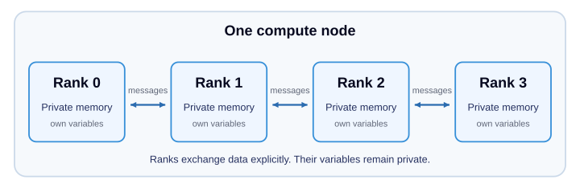
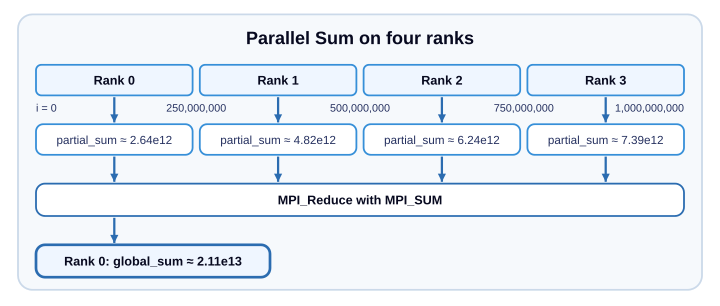
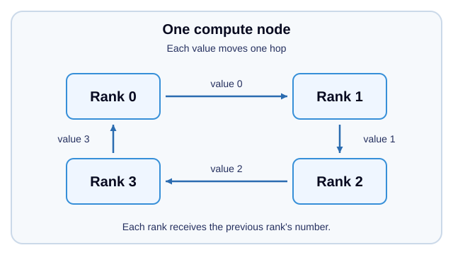

# Module 4 -- Distributed-Memory Parallelism with MPI

> **Time:** 11:10 AM to 12:00 PM CST · 50 min total · ~15 min lecture · ~35 min hands-on

## Learning Objectives

By the end of this module, you will be able to:

- Explain the message-passing model and how it differs from shared memory
- Write an MPI program that distributes work across multiple processes (ranks) on one node
- Explain point-to-point communication (`MPI_Send` / `MPI_Recv`)
- Recognize a deadlock and order messages to avoid it
- Use collective operations (`MPI_Reduce`)
- Test an agent's MPI code for a deadlock that a normal run can hide

---

## Session Plan

| Part | Time | Focus |
|---|---:|---|
| Key Concepts | 15 min | Private process memory, messages, and collectives |
| Exercise 1 | 4 min | Compile Hello World and run it with four ranks |
| Exercise 2 | 12 min | Complete the reduction, check the sum, and explore scaling |
| Exercise 3 | 10 min | Observe a deadlock, fix the ordering, and check the ring |
| Agent Practice | 9 min | Predict, inspect, and test a generated ring |

This is a suggested plan; queue waits and agent response times can change
it. If time is short, stop Agent Practice after the first four-rank
synchronous-send test and discuss what it shows. The
[extra tests](#extra-tests-optional) and the hybrid challenge are outside
this plan.

---

## Key Concepts

### Why MPI?

As you saw in Module 3, OpenMP threads work together through **shared
memory**. **MPI (Message Passing Interface)** takes a different approach:
a program runs as **multiple processes**, called **ranks**, and each rank
has its own private memory. Ranks coordinate by explicitly **sending and
receiving messages**. Because messages can travel over a network, the same
MPI program can run across many compute nodes, which threads sharing one
node's memory cannot do.

That is how programs grow beyond one node. Ranks on the same node exchange
messages through shared memory, while ranks on different nodes send them over
the high-speed network from Module 1.

In this tutorial, we focus on MPI within a single node: our tutorial partition
allows one node per job, so in this module you run 1 to 16 ranks on the CPU
cores of one compute node.
Sharing a node does not make the ranks' variables shared: each rank computes
its own partial result, and a message or collective operation combines data
from the different processes.



Both MPI and OpenMP can divide work among the node's CPU cores. The difference
you will practice is how they coordinate: OpenMP threads can update shared
variables, while MPI ranks exchange data explicitly. Keeping every rank on
one node doesn't change that programming model: the programs you write here
would run across nodes without changes.

### MPI Basics

Every MPI program follows this structure:

```c
#include <mpi.h>

int main(int argc, char **argv) {
    MPI_Init(&argc, &argv);          // Start MPI

    int rank, size;
    MPI_Comm_rank(MPI_COMM_WORLD, &rank);  // My rank (0, 1, 2, ...)
    MPI_Comm_size(MPI_COMM_WORLD, &size);  // Total number of ranks

    // ... do work ...

    MPI_Finalize();                  // Shut down MPI
    return 0;
}
```

**Key rule:** Every rank executes the **same program**, but branches based on
its rank number to do different work.

### Point-to-Point Communication

Send a message from one rank to another. This example requires at least two ranks:

```c
if (rank == 0) {
    int data = 42;
    MPI_Send(&data, 1, MPI_INT, 1, 0, MPI_COMM_WORLD);  // Send to rank 1
} else if (rank == 1) {
    int data;
    MPI_Recv(&data, 1, MPI_INT, 0, 0, MPI_COMM_WORLD, MPI_STATUS_IGNORE);
    printf("Rank 1 received: %d\n", data);  // Prints 42
}
```

### Collective Operations

Instead of manually sending between every pair of ranks, MPI provides
**collectives** that coordinate all ranks at once:

| Operation | What it does |
|-----------|-------------|
| `MPI_Bcast` | One rank sends the same data to all others |
| `MPI_Reduce` | All ranks contribute a value; one rank gets the combined result |
| `MPI_Allreduce` | Like Reduce, but every rank gets the result |
| `MPI_Scatter` | One rank distributes different pieces to each rank |
| `MPI_Gather` | Each rank sends a piece; one rank collects them all |


Example -- sum a value across all ranks:

```c
double local_sum = compute_my_part(rank);
double global_sum;
MPI_Reduce(&local_sum, &global_sum, 1, MPI_DOUBLE, MPI_SUM, 0, MPI_COMM_WORLD);
if (rank == 0)
    printf("Global sum = %f\n", global_sum);
```

### Compiling and Running

MPI programs are compiled with `mpicc`, a wrapper around `gcc` that adds the
MPI headers and libraries, and run with `srun`, which starts one copy of the
program for each rank. In general, for a program in `program.c`:

```bash
mpicc -O2 -o program program.c                                       # Compile (fine on the login node)
srun --partition=mi2101x --nodes=1 --time=2:00 --ntasks=4 ./program  # Run 4 ranks on a compute node
```

`--nodes=1` places all ranks on one compute node. `--ntasks=4` tells `srun`
to launch four ranks, each running one copy of the program. A node has 16 CPU
cores, so you can use up to 16 ranks. You'll compile and run real programs
this way in the exercises below.

---

## Hands-On Exercises (~35 min)

Follow the Session Plan above, including Agent Practice. Complete these
activities before trying the optional extra tests or the hybrid challenge.

From the repository root on the login node, navigate to this module's exercises:

```bash
cd module-04-mpi/exercises
```

### Exercise 1: Run an MPI Hello World

#### Step 1: Examine the Program

Examine the MPI hello-world program:

```bash
cat ../examples/mpi_hello.c
```

#### Step 2: Compile on the Login Node

```bash
mpicc -O2 -o mpi_hello ../examples/mpi_hello.c
```

#### Step 3: Run with Four Ranks

Run the program on a compute node with four ranks:

```bash
srun --partition=mi2101x --nodes=1 --time=2:00 --ntasks=4 ./mpi_hello
```

#### Step 4: Examine the Output

Each rank reports a different ID, the same total of 4 ranks, and the same
compute node. The ranks may print in any order (that's normal for parallel
programs). Exercise 2's batch job runs 1 to 16 ranks in a single job, so you
don't need to start a separate job for each rank count.

---

### Exercise 2: Parallel Sum with MPI_Reduce

#### Step 1: Open the Template

Open the exercise template in an editor on the login node:

```bash
vim parallel_sum.c
```

In Vim, press `i` to enter insert mode and make your edits. Press `Esc`, type
`:wq`, and press `Enter` to save and exit. You can instead use `nano`, `emacs`,
or an existing VS Code Remote SSH connection.

The program divides an index range across ranks. Each rank computes
`sqrt(i)` for the indices in its range and adds those values locally, then
`MPI_Reduce` combines the partial sums into a global total. No array is stored
or distributed.



#### Step 2: Complete the TODOs

There are **4 TODOs** to fill in:

1. **TODO 1**: Initialize MPI
2. **TODO 2**: Get the rank and size
3. **TODO 3**: Use `MPI_Reduce` to sum the partial results
4. **TODO 4**: Finalize MPI

Write the reduction at TODO 3, before the rank-0 printing condition: every
rank must call it, or rank 0 waits forever for the missing contributions.

**Code reference for the TODOs:**

| Argument or value | Meaning in this exercise |
|---|---|
| `MPI_COMM_WORLD` | The communicator containing all ranks in this program |
| `rank`, `size` | This process's ID and the number of participating ranks |
| Count `1` and `MPI_DOUBLE` | Each rank contributes one double-precision partial sum |
| `MPI_SUM` | Add those contributions |
| Root `0` | Rank 0 receives the combined result |

Every rank must call the reduction with matching communicator, root, count,
datatype, and operation. Only the root uses the resulting `global_sum`.

#### Step 3: Compile on the Login Node

After filling in the TODOs, compile the program:

```bash
mpicc -O2 -o parallel_sum parallel_sum.c -lm
```

#### Step 4: Submit the Batch Job

The batch script runs your completed program with 1, 2, 3, 4, 8, and 16 ranks,
one after another in a single job on one compute node:

```bash
sbatch submit_mpi.sh
```

Note the job ID printed by `sbatch` and wait for the job to finish. You can
check pending and running jobs with `squeue -u $USER`. Disappearing from that
list does not tell you whether a job succeeded.

#### Step 5: Examine the Output

Replace `<JOBID>` with your job ID:

```bash
cat mpi-sum_<JOBID>.out
cat mpi-sum_<JOBID>.err
sacct -j <JOBID> --format=JobID,JobName%20,State,ExitCode
```

Check that the job and all six numbered run steps are `COMPLETED` with exit
code `0:0`, and inspect the error log. Accounting can take a moment to appear;
if it is empty, try again shortly. The batch script stops at the first failed
run, so fewer than six results blocks means the sweep is incomplete. See
[Module 2's job-lifecycle exercise](../module-02-slurm/README.md#exercise-1-observe-the-job-lifecycle),
Step 5, for more on completed jobs.

With the default 1 billion terms, expect a positive sum of approximately
`2.11e13` (about 21,082,000,000,000). Check this magnitude first, then use the
one-rank global sum as a consistency baseline for the other rank counts. They
should match it in at least the first 12 digits. Floating-point addition can
change the last digits when the order of addition changes, so
`21081851051977.78` and `21081851051978.81` agree.

The reported time covers rank 0's local calculation and reduction interval;
it excludes job startup. Use it to explore scaling. Reliable benchmarking
would need repeated measurements and coordinated timing across ranks.

Copy this table into your notes and fill it in from the output, as you did
for OpenMP in Module 3. Speedup is the 1-rank time divided by the N-rank time:

| Ranks | Time (s) | Speedup |
|-------|----------|---------|
| 1     |          | 1.0     |
| 2     |          |         |
| 3     |          |         |
| 4     |          |         |
| 8     |          |         |
| 16    |          |         |

**Questions:**
- Does the sum have the expected magnitude?
- Do the global sums at 2, 3, 4, 8, and 16 ranks agree with the one-rank
  baseline?
- How does the time change from 1 rank to 16 ranks? How does your speedup
  compare with your OpenMP pi speedup from Module 3? These are different
  calculations, so compare their scaling trends, not their absolute times.
  If both scale about as well on one node, why would you still choose MPI?
  (Hint: see "Why MPI?" above.) How does combining MPI partial sums differ
  from an OpenMP reduction?
- What would happen if you forgot the `MPI_Reduce` and just printed each
  rank's partial sum?

#### Step 6: Check the Remainder Handling

Find the three-rank block in the same output. 1 billion is not divisible by
three, so the last rank computes one extra term. Its global sum should still
match the one-rank baseline in at least the first 12 digits.

---

### Exercise 3: Pass Messages Around a Ring

In a ring pattern, each rank sends its rank number to the next rank and
receives the previous rank's number. Each value moves one hop. The last rank
sends back to rank 0:



#### Step 1: Open the Template

Open the template in an editor on the login node:

```bash
vim ring.c
```

#### Step 2: See a Deadlock First

Start with the simplest idea: every rank sends, then receives. Put these two
lines at the TODO:

```c
MPI_Ssend(&send_val, 1, MPI_INT, dest, 0, MPI_COMM_WORLD);
MPI_Recv(&recv_val, 1, MPI_INT, source, 0, MPI_COMM_WORLD, MPI_STATUS_IGNORE);
```

Compile it, then run it under `timeout 10`, which stops each rank after 10
seconds:

```bash
mpicc -O2 -o ring ring.c
srun --partition=mi2101x --nodes=1 --time=1:00 --ntasks=4 timeout 10 ./ring
```

After the job-submission filter's checks, the program prints nothing and hangs.
`MPI_Ssend` (synchronous send) does not finish until the receiving rank has
started its receive, but every rank is stuck sending, so no rank ever reaches
`MPI_Recv`. This is a **deadlock**.
After 10 seconds, `timeout` stops the ranks and `srun` reports
`Exited with exit code 124`. In this module, exit code 124 means the program
was still waiting when its 10 seconds ran out. Each run reserves a whole
compute node, so the time limit keeps a hung program from holding one any
longer. To stop it sooner, press `Ctrl-C` twice within a second.

To see the waiting step by step, open the ring deadlock explorer. Choose four
ranks, *Every rank sends first*, and `MPI_Ssend`, then press **Step**. Then
switch to `MPI_Send` to see how buffering hides the problem. The explorer runs
on the tutorial website; GitHub shows only its source.

<a href="../_static/mpi-deadlock-explorer.html">Open the ring deadlock explorer</a>

With plain `MPI_Send`, this same code often works, because MPI copies small
messages into a buffer and returns right away. Larger messages, or another
MPI library, can make it deadlock, so correct programs never rely on that
buffering.

#### Step 3: Fix the Ordering

Replace those two lines so the exchange can't deadlock. Fill in the TODO to
send `send_val` to `dest` and receive a value from `source` into `recv_val`.
Use `MPI_Send` and `MPI_Recv`, or explore `MPI_Sendrecv` as an alternative.
With two or more ranks, a correct ordering works even with `MPI_Ssend`, which
makes it a good test.

> **Tip**
>
> Plan the order of the sends and receives. If every rank starts with a blocking
> receive, no rank can send. Starting with blocking sends can also deadlock if
> the messages cannot be buffered. Consider alternating the order for even and
> odd ranks, or use `MPI_Sendrecv` to coordinate the exchange.

#### Step 4: Compile and Run

Compile on the login node:

```bash
mpicc -O2 -o ring ring.c
```

Run on a compute node with four ranks:

```bash
srun --partition=mi2101x --nodes=1 --time=1:00 --ntasks=4 timeout 10 ./ring
```

If `srun` reports exit code 124, the ordering still deadlocks: revisit Step 3.
Each rank should receive the previous rank's number. With four ranks, rank 0
should receive `3` from rank 3 and report that ring communication succeeded.
The output lines may appear in any order.

Check every rank's source, destination, and received value. The provided
checker independently calculates each rank's expected value and combines
failures with `MPI_Allreduce`. The success banner means every rank's value
matched; if any value is wrong, every rank exits with status 1 and `srun`
reports a nonzero exit. A run that hangs cannot reach this value check.

In general, rank 0 receives `size - 1`. To try other rank counts, use the
single batch job in the [extra tests](#extra-tests-optional) rather than more
`srun` commands.

#### Step 5: Compare with the Solution

After completing your implementation, read the solution:

```bash
cat solutions/ring_solution.c
```

It uses `MPI_Sendrecv`, which sends and receives in one call, as if both
happened at once, so it can't deadlock the way blocking sends and receives in
the wrong order can. Compare it with your ordering; you don't need to run it.

---

### Agent Practice: Test the Agent's Ring

Code that runs once isn't necessarily correct. In Step 2 you saw a ring that
deadlocks when messages aren't buffered. Now have the agent write a ring, and
use the same trick to expose an ordering that relies on buffering.

#### Step 1: Ask for a Ring

Start Qwen Code:

```bash
bash ../../setup/launch_qwen.sh
```

Ask it:

> Write ring_agent.c: an MPI program in which every rank sends its rank number to the next rank (the last rank sends to rank 0) and receives from the previous rank, then prints a line `Rank <r> received <v>`. Use MPI_Send and MPI_Recv.

Before you approve the file, read the sends and receives. Predict: would this
version deadlock if MPI couldn't buffer the messages? You can check a
prediction in the ring deadlock explorer from Exercise 3.

With four ranks, ranks 0, 1, 2, and 3 should receive 3, 0, 1, and 2. Press
`Ctrl+S` if Qwen shows only part of the file. Approve only `ring_agent.c`;
decline any other file it offers to write and any request to run programs or
submit jobs, and ignore any follow-up prompt it suggests. Then type `/quit` to
return to the shell.

#### Step 2: Test It Without Buffering

Make a copy in which every `MPI_Send(` call becomes `MPI_Ssend(`, then list
the copy's communication calls:

```bash
sed -E 's/\bMPI_Send[[:space:]]*\(/MPI_Ssend(/g' ring_agent.c > ring_ssend.c
grep -nE 'MPI_(Ssend|Send|Isend|Recv|Irecv|Sendrecv|Wait)' ring_ssend.c
```

Ignoring comments, every send should now be `MPI_Ssend`, with the receives
unchanged. If you see no `MPI_Ssend`, or you see `MPI_Sendrecv`, `MPI_Isend`,
or `MPI_Irecv`, the agent didn't use the requested calls: restart Qwen and
ask it for `MPI_Send` and `MPI_Recv` first. Then compile and run the copy:

```bash
mpicc -O2 -o ring_ssend ring_ssend.c &&
  srun --partition=mi2101x --nodes=1 --time=1:00 --ntasks=4 timeout 10 ./ring_ssend
```

If `srun` reports exit code 124, the copy hung, so the agent's ordering relies
on buffering. Restart Qwen with the same launcher, describe what you observed
(for example, "ring_ssend.c, a copy of ring_agent.c that uses MPI_Ssend, hung
with four ranks"), and ask it to fix that one problem in **`ring_agent.c`**.
Type `/quit`, then repeat the `sed`, `grep`, and compile commands instead of
rerunning the old copy. After one repair attempt, note any remaining issue
and move on.

If the copy finishes, check the four received values against Step 1: the
agent's program may not include the template's checker. A passing four-rank
test is evidence for four ranks only; the [extra tests](#extra-tests-optional)
try other rank counts.

**Questions:**
- Which ordering did the agent use? Is it the same idea as yours?
- Did it follow the instruction to use `MPI_Send` and `MPI_Recv`? If not, did
  you notice before running it?
- Why does the `MPI_Ssend` test tell you more than a run that happens to work?

---

### Extra Tests (Optional)

If you finish early, test other rank counts with **one** batch job instead of
separate `srun` commands. `test_ring.sh` runs a ring program with 1, 2, 3, and
8 ranks as steps of a single job. It stops any run that is still waiting after
10 seconds (exit code 124) and goes on to the next count:

```bash
sbatch test_ring.sh ./ring          # your Exercise 3 program
sbatch test_ring.sh ./ring_ssend    # the MPI_Ssend copy of the agent's ring
```

Note each job ID, wait for the job to finish, then read
`ring-test_<JOBID>.out`. In every block, rank 0 should receive `size - 1` and
every other rank the previous rank's number; your Exercise 3 program also
reports whether every value matched. If any count fails or hangs, the output
says which one, and the job ends `FAILED`.

- **One rank:** both neighbors are rank 0, so expect `Rank 0 received 0`. A
  rank that starts with a blocking send to itself can't reach its own
  receive, so with `MPI_Ssend` that ordering hangs. If only the one-rank run of
  the agent's copy hangs, describe that result to the agent and ask it to fix
  that one problem in `ring_agent.c`. Then repeat the `sed` and `grep`
  commands, recompile, and submit the test again.
- **Check the checker:** copy your completed program with
  `cp ring.c ring_broken.c`, and in the copy add `if (rank == 1) recv_val = 99;`
  just before the output and checking code. Leave the expected value and
  validation unchanged. Compile it with
  `mpicc -O2 -o ring_broken ring_broken.c` and submit
  `sbatch test_ring.sh ./ring_broken`. Every block with two or more ranks
  should report a mismatch and failure, even though rank 0 received the
  right value.

---

### Additional Challenges

If you finish the exercises above early, try the
[hybrid MPI + OpenMP challenge](../challenges/README.md#module-4-mpi-challenges):
combine MPI ranks with OpenMP threads and compare ways of splitting a node's
cores between them. You can also come back to it after the tutorial.

---

## Quick Reference

| Function | Purpose |
|----------|---------|
| `MPI_Init(&argc, &argv)` | Initialize MPI |
| `MPI_Finalize()` | Shut down MPI |
| `MPI_Comm_rank(comm, &rank)` | Get my rank ID |
| `MPI_Comm_size(comm, &size)` | Get total number of ranks |
| `MPI_Send(buf, count, type, dest, tag, comm)` | Send data to a rank |
| `MPI_Recv(buf, count, type, src, tag, comm, status)` | Receive data from a rank |
| `MPI_Ssend(buf, count, type, dest, tag, comm)` | Send, waiting until the receiver has started receiving |
| `MPI_Sendrecv(...)` | Send to one rank and receive from another in one call |
| `MPI_Reduce(sendbuf, recvbuf, count, type, op, root, comm)` | Combine values across ranks |
| `MPI_Allreduce(sendbuf, recvbuf, count, type, op, comm)` | Combine values and give every rank the result (used by the Ring checker) |
| `MPI_Bcast(buf, count, type, root, comm)` | Broadcast from one rank to all |

| MPI Datatype | C Type |
|-------------|--------|
| `MPI_INT` | `int` |
| `MPI_LONG` | `long` |
| `MPI_DOUBLE` | `double` |
| `MPI_CHAR` | `char` |

| Reduction Op | Meaning |
|-------------|---------|
| `MPI_SUM` | Sum |
| `MPI_MAX` | Maximum |
| `MPI_MIN` | Minimum |

---

**Next up:** [Module 5 -- GPU Programming with HIP](../module-05-hip/README.md)
