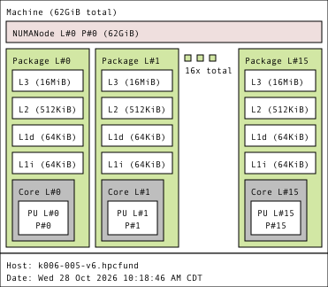
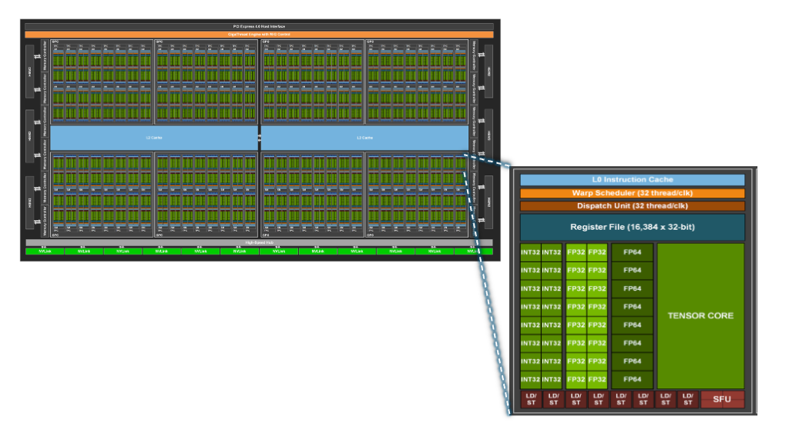
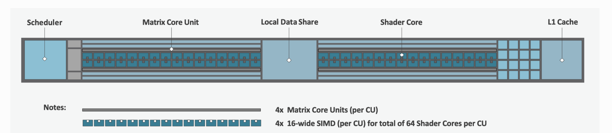

# Module 5 -- GPU Programming with HIP

> **Time:** 12:45 to 1:45 PM CST · 60 min total · ~20 min lecture · ~40 min hands-on

## Learning Objectives

By the end of this module, you will be able to:

- Describe GPU architecture and how it differs from a CPU
- Write a HIP kernel that runs on the AMD MI210 GPU
- Manage data transfers between host (CPU) and device (GPU) memory
- Choose thread and block dimensions for a kernel launch

---

## Key Concepts

### Why GPUs?

A CPU has a few powerful cores optimized for complex, sequential tasks. A GPU
has **thousands of simpler cores** optimized for doing the same operation on
many data elements at once. And because of that, if you can break up a problem into small
calculations that can be done in parallel, a GPU is much much faster.


CPU:


GPU:



When your problem involves applying the same math to millions of data points
(vector operations, matrix multiply, neural network layers), GPUs can be
10-100x faster than CPUs.
However, a GPU cannot do more specialized tasks like managing IO, network communication[^1], interacting
with other devices. You still need a CPU for that.


### The AMD MI210

Our compute nodes each have an **AMD Instinct MI210** GPU:

| Spec | MI210 |
|------|-------|
| Compute Units | 104 |
| Stream Processors | 6656 |
| Memory | 64 GB HBM2e |
| Memory Bandwidth | 1.6 TB/s |
| Architecture | CDNA2 (gfx90a) |

TODO: what do these mean? What is a compute unit, stream processor, memory, memory bandwidth (why is memory bandwidth important)? 

What do these terms mean? 

#### Stream Processor

Stream processor is a term used to reference any individual arithmatic unit present in a GPU. In Nvidia
GPUs, they might be called CUDA cores. You can think of them as equivalent to a "core" on a CPU in
which a single thread can run to execute instructions. They can be specialized for specific datatypes, for example 
AMD GPUs have matrix cores which are specialized for performing operations on matrices efficiently.


#### Compute Unit
A compute unit looks something like this (TODO insert diagram)

A compute unit is a collection of these stream processors or cores, along with other
infrastructure that they need to schedule threads and run instructions on these stream processors. For example, here is a diagram of a compute unit from an AMD MI250X
GPU. 




TODO: update the above two sections after having read programming massively parallel processors

You can read more about these two concepts in the [ROCm documentation](https://rocm.docs.amd.com/projects/rocprofiler-compute/en/latest/conceptual/cdna/compute-unit.html)
and [in these slides](https://www.olcf.ornl.gov/wp-content/uploads/2019/09/AMD_GPU_HIP_training_20190906.pdf)

#### Memory and Memory Bandwidth

A GPU obviously needs to operate on some data, and this data needs to live somewhere. Every computer
has RAM, but that is too far away and would be too slow to access by the GPU. So a GPU usually comes with with
its own RAM that is close to the chip. Because usually GPUs are meant for high throughput computing, it is useful for the GPUs
RAM to be large enough to store a large amount of data to avoid having to reach out to the CPU
memory frequently. And also because computational parts of GPUs are able to churn through a large amount of data 
quickly, the GPU should not be bottlenecked by how much data can be read from the GPU memory at a
time, so the GPU memory should be high bandwidth so that large amounts of data at a time can be read
from the memory.


#### Architecture

Architecture refers to the overall design of the GPU. The individual decisions and compromises that are made to
allow the GPU to do what it does efficiently, including things like number of cores and compute
units in a GPU, what specialized cores are included, how much memory and bandwidth it has, etc. Architectures are always iterated on and improved
between different generations of GPUs, based on the lessons learned in previous generations and to
move with the times of how GPUs are being used. For example, matrix cores (or tensor cores on Nvidia
GPUs) are prevalent now in datacenter GPUs as it became clear hardware support for matrix
multiplications is useful for machine learning workloads.


### HIP: Portable GPU Programming

**HIP (Heterogeneous-compute Interface for Portability)** is AMD's GPU
programming framework. It's designed to be nearly identical to NVIDIA's CUDA,
so code is portable across AMD and NVIDIA GPUs.

HIP allows you to write high level code in C++ that can be compiled down to a binary that will
run on the CPU or GPU (depending on the code). 

TODO: what does a GPU assembly code look like? How does that compare to HIP code and why is that easier to understand?

### The Programming Model

A HIP program has two parts:

- **Host code** (runs on CPU): manages memory (allocates memory on GPU, copies data to GPU memory), launches kernels
- **Device code** (runs on GPU): consists of the **kernel**. This is the function that you write
 that will run in parallel with many threads on the GPU


```
  Host (CPU)                    Device (GPU)
  ──────────                    ────────────
  1. Allocate GPU memory        
  2. Copy data to GPU    ──►   
  3. Launch kernel        ──►   Each thread processes one element
  4. Copy results back   ◄──   
  5. Free GPU memory            
```


### Threads, Blocks, and Grids

When you launch a kernel, you specify how many threads to create, organized
into a hierarchy:

```
  Grid (all threads)
  ├── Block 0:  [Thread 0] [Thread 1] ... [Thread 255]
  ├── Block 1:  [Thread 0] [Thread 1] ... [Thread 255]
  ├── Block 2:  [Thread 0] [Thread 1] ... [Thread 255]
  └── ...
```

All of these threads are (conceptually) running at the same time i.e. each thread is executing the same
code. So you need to be able to tell each thread which portion of the data it should operate on when executing the
code based on the thread's id. 

Say you have two arrays, `a` and `b` and you want to do an elementwise sum and store them in array
`c`. 

```
# assume N is some super large number
int a[N] = {1,2,3,4,5 ...... N};
int b[N] = {1,2,3,4,5 ...... N};
int c[N];
```

In a sequential code, we would write a for loop
```
for(int i=0; i<N; i++) {
c[i] = a[i] + b[i];
}
```

Because threads in a GPU run in parallel, we can have thousands of threads with each thread can do the below operation.

```
# addition of two array elements
c[i] = a[i] + b[i];
```

In order to do that, you need to allow each thread to have it's own value of `i`. But you have to
make sure two different threads aren't using the same `i` value. How can we do that?


Each thread computes its **global index** to know which data element to process:

```cpp
int i = blockIdx.x * blockDim.x + threadIdx.x;
```

<a href="/_static/thread_index_visualizer.html">Let's try to visualize with a visualization.</a>

This `i` now effectively identifies the thread differentiating it from all the threads in the grid. So in your kernel,
if you have the operation 

```
# addition of two array elements
c[i] = a[i] + b[i];
```

The 'i'th thread performs this operation for the 'i'th elements of a,b, and c.


<a href="/_static/thread_index_with_vecadd_visualizer.html">Let's see the visualization again, this time with the array addition</a>.

| Variable | Meaning |
|----------|---------|
| `threadIdx.x` | Thread index within its block (0 to blockDim-1) |
| `blockIdx.x` | Block index within the grid |
| `blockDim.x` | Number of threads per block |
| `gridDim.x` | Number of blocks in the grid |


### Kernel Syntax

```cpp
// Kernel definition (runs on GPU)
__global__ void add_vectors(const double *a, const double *b, double *c, int n) {
    int i = blockIdx.x * blockDim.x + threadIdx.x;
    if (i < n) {
        c[i] = a[i] + b[i];
    }
}

// Launch from host
int threads_per_block = 256;
int blocks = (n + threads_per_block - 1) / threads_per_block;
add_vectors<<<blocks, threads_per_block>>>(d_a, d_b, d_c, n);
```

We create our kernel function `add_vectors` which adds two arrays together and stores the result in
a third array `c`.

We see here that we setup the number of threads per block, the total number of blocks, derived from
the value n which is the size of our arrays (you'll see this in the example).

We "launch" the `add_vectors` kernel with the `kernelname<<< >>>` syntax. We specify the grid size
(i.e. number of blocks) and the block size (i.e. number of threads per block) 

TODO: add diagram showing a blow up of a specific thread in a grid diagram, showing that thread doing the addition

### Memory Management

We talked about the computing part of this array addition so far. But what about the data. Obviously
that has to come from somewhere. How does that data get to the GPU? We talked earlier that GPUs have
their own RAM as it is faster for GPUs to access and use RAM integrated onto their device instead of
needing to go to a different device. So any data that exists on disk or in CPU RAM needs to copied over to the GPU RAM.
And just like CPU RAM, we need to allocate space on the GPU RAM first before we can copy anything to
it.

So expanding on the previous code snippet a little bit, we can do something like this:

```
// assume we already have arrays h_a, h_b, h_c allocated in CPU memory

/* Allocate device (GPU) memory */
double *d_a, *d_b, *d_c;
HIP_CHECK(hipMalloc(&d_a, bytes));
HIP_CHECK(hipMalloc(&d_b, bytes));
HIP_CHECK(hipMalloc(&d_c, bytes));

/* Copy inputs from host to device */
HIP_CHECK(hipMemcpy(d_a, h_a, bytes, hipMemcpyHostToDevice));
HIP_CHECK(hipMemcpy(d_b, h_b, bytes, hipMemcpyHostToDevice));

// Launch from host
int threads_per_block = 256;
int blocks = (n + threads_per_block - 1) / threads_per_block;
add_vectors<<<blocks, threads_per_block>>>(d_a, d_b, d_c, n);

/* Copy results back to host */
HIP_CHECK(hipMemcpy(h_c, d_c, bytes, hipMemcpyDeviceToHost));
```

There are some advances with modern GPUs. Some are able to transparently copy data from CPU memory
and cache it on GPU memory whenever you try to access something in the CPU memory from the GPU,
saving you the need to explicitly allocate memory and copy data. Some devices are combine a CPU and
GPU in one device and share the same RAM between both of them (called "unified memory"), so there is
no difference between a CPU reading and writing to a memory location and a GPU doing it. But it is
still valuable to understand the data movement behavior even if you might not
explicitly be using it in your code.

| Function | Purpose |
|----------|---------|
| `hipMalloc(&ptr, size)` | Allocate memory on the GPU |
| `hipMemcpy(dst, src, size, kind)` | Copy data between host and device |
| `hipFree(ptr)` | Free GPU memory |

Copy directions:
- `hipMemcpyHostToDevice` -- CPU to GPU
- `hipMemcpyDeviceToHost` -- GPU to CPU


## Hands-On Exercises 

First, navigate to the exercises directory for this module:

```bash
cd module-05-hip/exercises
```

### Exercise 1: Run HIP Vector Addition

#### Step 1: Examine the Program

Examine the complete vector addition program:

```bash
cat ../examples/vector_add.cpp
```

#### Step 2: Compile the Program

```bash
hipcc -O2 -o vector_add ../examples/vector_add.cpp
```

#### Step 3: Run on a Compute Node

```bash
srun --partition=mi2101x --nodes=1 --time=2:00 --ntasks=1 ./vector_add
```

#### Step 4: Study the HIP Workflow

Study the code carefully. Note the pattern:
1. Allocate host arrays and initialize them
2. Allocate device arrays with `hipMalloc`
3. Copy input data to device with `hipMemcpy`
4. Launch the kernel with `<<<blocks, threads>>>`
5. Copy results back to host
6. Verify and free memory

---

### Exercise 2: Vector Scale

#### Step 1: Open the Template

Open the exercise template:

```bash
cat vector_scale.cpp
```

This program should multiply every element of a vector by a constant:
`result[i] = alpha * input[i]`

#### Step 2: Complete the TODOs

There are **4 TODOs** to fill in:

1. **TODO 1**: Write the kernel function
2. **TODO 2**: Copy input data from host to device
3. **TODO 3**: Calculate grid dimensions and launch the kernel
4. **TODO 4**: Copy results from device back to host

#### Step 3: Compile the Program

```bash
hipcc -O2 -o vector_scale vector_scale.cpp
```

#### Step 4: Submit the Batch Job

```bash
sbatch submit_hip.sh
```

#### Step 5: Examine the Output

```bash
cat hip-exercise_<JOBID>.out
```

The program verifies the results against a CPU reference. If everything is
correct, you'll see "PASSED".

---

### Exercise 3: Experiment with Block Sizes

#### Step 1: Choose Block Sizes

Modify `vector_scale.cpp` (or the solution) to try different block sizes.
Edit the `BLOCK_SIZE` define before compiling each version.

#### Step 2: Compile and Run the Experiments

```bash
# Try block sizes: 64, 128, 256, 512
hipcc -O2 -DBLOCK_SIZE=64  -o vector_scale vector_scale.cpp
srun --partition=mi2101x --nodes=1 --time=2:00 --ntasks=1 ./vector_scale

hipcc -O2 -DBLOCK_SIZE=512 -o vector_scale vector_scale.cpp
srun --partition=mi2101x --nodes=1 --time=2:00 --ntasks=1 ./vector_scale
```

Does the block size affect performance or correctness?

---


## Quick Reference

| HIP Function | Purpose |
|-------------|---------|
| `hipMalloc(&ptr, bytes)` | Allocate GPU memory |
| `hipFree(ptr)` | Free GPU memory |
| `hipMemcpy(dst, src, bytes, dir)` | Copy data (host↔device) |
| `hipDeviceSynchronize()` | Wait for GPU to finish |
| `hipGetLastError()` | Check for kernel launch errors |

| Kernel Syntax | |
|--------------|---|
| `__global__ void kernel(...)` | Declare a GPU kernel |
| `kernel<<<blocks, threads>>>(...)` | Launch the kernel |
| `threadIdx.x` | Thread ID within block |
| `blockIdx.x` | Block ID within grid |
| `blockDim.x` | Threads per block |

| Compile & Run | |
|--------------|---|
| `hipcc -O2 -o prog prog.cpp` | Compile HIP code |
| `srun --partition=mi2101x ./prog` | Run on a GPU node |

## Additional Resources

- [Youtube HIP tutorial playlist](https://www.youtube.com/watch?v=9ZGpM3zXKoY&list=PLB1fSi1mbw6IKbZSPz9a2r2DbnHWnLbF-) 
- [HIP documentation](https://rocmdocs.amd.com/projects/HIP/en/latest/index.html)

---

**Next up:** [Module 6 -- AI on HPC: Inference & Fine-Tuning](../module-06-ai-inference-finetuning/README.md)

[^1]: with some nuances. Some GPUs can be directly connected to the network rather than having to
    pass their data to the CPU first before communicating with another node. This speeds up some
    massive applications that need to be split across hundreds of nodes, by taking away the extra
    step of copying data to the CPU first before doing network communication.
