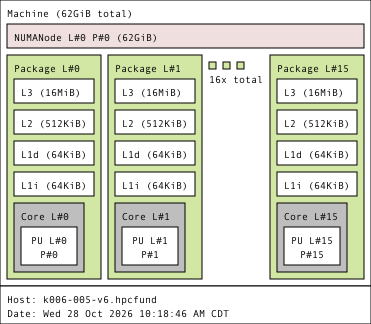
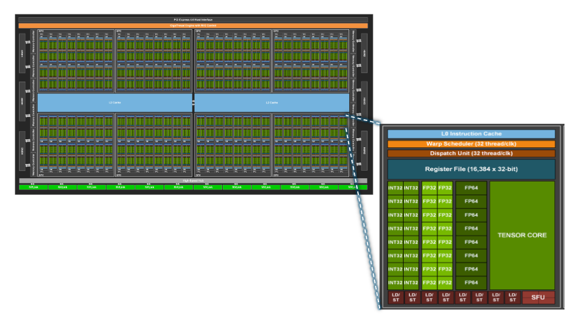
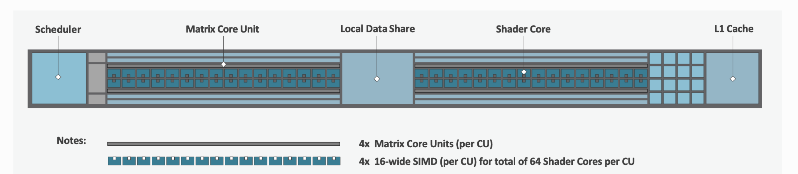

# Module 5 -- GPU Programming with HIP

> **Time:** 12:45 to 1:45 PM CST · 60 min total · ~20 min lecture · ~40 min hands-on

## Learning Objectives

By the end of this module, you will be able to:

- Describe GPU architecture and how it differs from a CPU
- Write a HIP kernel that runs on the AMD MI210 GPU
- Manage data transfers between host (CPU) and device (GPU) memory
- Choose thread and block dimensions for a kernel launch
- Check HIP calls and kernel launches for errors, knowing that launches are asynchronous
- Measure a kernel's performance and explain what limits it
- Decide whether a program's output gives enough evidence to verify its result

---

## Key Concepts

### Why GPUs?

CPUs emphasize low latency and strong performance on individual threads. GPUs
emphasize high throughput by executing many threads in parallel. They work
best when a problem exposes substantial parallelism, such as applying similar
operations to many array elements: vector operations, matrix multiplication,
and neural network layers.

How much faster a GPU is depends on the workload, how it is implemented, the
problem size, and whether you count the time to move data between CPU and GPU
memory. Those copies are slow compared with the GPU's own memory, so real
applications copy their data to the GPU once and keep it there across many
kernels, which reduces the transfer overhead. You'll measure this in
Exercise 1.

CPU:



GPU:



However, a GPU cannot do more specialized tasks like managing IO, network communication[^1], interacting
with other devices. You still need a CPU for that.

### The AMD MI210

Our compute nodes each have an **AMD Instinct MI210** GPU:

| Spec | MI210 |
|------|-------|
| Compute Units | 104 |
| Stream Processors | 6656 |
| Wavefront size | 64 threads |
| Maximum threads per block | 1024 |
| Memory | 64 GB HBM2e |
| Memory Bandwidth | 1.6 TB/s |
| Architecture | CDNA2 (gfx90a) |

#### Stream Processor

Stream processor is a term used to reference any individual arithmatic unit present in a GPU. In Nvidia
GPUs, they might be called CUDA cores. You can think of them as equivalent to a "core" on a CPU in
which a single thread can run to execute instructions. They can be specialized for specific datatypes, for example 
AMD GPUs have matrix cores which are specialized for performing operations on matrices efficiently.


#### Compute Unit

A compute unit is a collection of these stream processors or cores, along with other
infrastructure that they need to schedule threads and run instructions on these stream processors. For example, here is a diagram of a compute unit from an AMD MI250X
GPU. 




You can read more about these two concepts in the [ROCm documentation](https://rocm.docs.amd.com/projects/rocprofiler-compute/en/latest/conceptual/cdna/compute-unit.html)
and [in these slides](https://www.olcf.ornl.gov/wp-content/uploads/2019/09/AMD_GPU_HIP_training_20190906.pdf)


#### Wavefront

This refers to a group of threads that are always scheduled together. It is the smallest unit of
execution on an AMD GPU (you might see this referred to as a 'warp' on Nvidia GPUs). All threads in a wavefront
execute the same instruction in lockstep on different data elements. On AMD GPUs, a wavefront is 64
threads. 

#### Memory and Memory Bandwidth

A GPU obviously needs to operate on some data, and this data needs to live
somewhere. Every computer has RAM, but that is too far away and would be too
slow to access by the GPU. So a GPU usually comes with with its own RAM that is
close to the chip. Because usually GPUs are meant for high throughput
computing, it is useful for the GPUs RAM to be large enough to store a large
amount of data to avoid having to reach out to the CPU memory frequently. And
also because computational parts of GPUs are able to churn through a large
amount of data quickly, the GPU should not be bottlenecked by how much data can
be read from the GPU memory at a time, so the GPU memory should be high
bandwidth so that large amounts of data at a time can be read from the memory.


#### Architecture

Architecture refers to the overall design of the GPU. The individual decisions
and compromises that are made to allow the GPU to do what it does efficiently,
including things like number of cores and compute units in a GPU, what
specialized cores are included, how much memory and bandwidth it has, etc.
Architectures are always iterated on and improved between different generations
of GPUs, based on the lessons learned in previous generations and to move with
the times of how GPUs are being used. For example, matrix cores (or tensor
cores on Nvidia GPUs) are prevalent now in datacenter GPUs as it became clear
hardware support for matrix multiplications is useful for machine learning
workloads.

### HIP: Portable GPU Programming

**HIP (Heterogeneous-compute Interface for Portability)** is AMD's GPU
programming interface. Its API closely mirrors NVIDIA's CUDA, and HIP code can
be compiled for both AMD and NVIDIA GPUs. Moving code between them can still
take work when it makes assumptions about the hardware (such as the wavefront
size), depends on vendor-specific libraries, or uses a feature that one
platform doesn't support.

HIP allows you to write high level code in C++ that can be compiled down to a binary that will
run on the CPU or GPU (depending on the code). 

### The Programming Model

A HIP program has two parts:

- **Host code** (runs on CPU): manages memory (allocates memory on GPU, copies data to GPU memory), launches kernels
- **Device code** (runs on GPU): consists of the **kernel**. This is the function that you write
 that will run in parallel with many threads on the GPU

```
  Host (CPU)                    Device (GPU)
  ──────────                    ────────────
  1. Allocate GPU memory        
  2. Copy data to GPU    ──►   
  3. Launch kernel        ──►   Each thread processes one or more elements
  4. Copy results back   ◄──   
  5. Free GPU memory            
```

### Threads, Blocks, and Grids

When you launch a kernel, you specify how many threads to create, organized
into a hierarchy:

```
  Grid (all threads)
  ├── Block 0:  [Thread 0] [Thread 1] ... [Thread 255]
  ├── Block 1:  [Thread 0] [Thread 1] ... [Thread 255]
  ├── Block 2:  [Thread 0] [Thread 1] ... [Thread 255]
  └── ...
```

All of these threads are (conceptually) running at the same time i.e. each thread is executing the same
code. So you need to be able to tell each thread which portion of the data it should operate on when executing the
code based on the thread's id. 

Say you have two arrays, `a` and `b` and you want to do an elementwise sum and store them in array
`c`. 

```
# assume N is some super large number
int a[N] = {1,2,3,4,5 ...... N};
int b[N] = {1,2,3,4,5 ...... N};
int c[N];
```

In a sequential code, we would write a for loop
```
for(int i=0; i<N; i++) {
c[i] = a[i] + b[i];
}
```

Because threads in a GPU run in parallel, we can have thousands of threads with each thread can do the below operation.

```
# addition of two array elements
c[i] = a[i] + b[i];
```

In order to do that, you need to allow each thread to have it's own value of `i`. But you have to
make sure two different threads aren't using the same `i` value. How can we do that?


Each thread computes its **global index** to know which data element to process:

```cpp
int i = blockIdx.x * blockDim.x + threadIdx.x;
```


| Variable | Meaning |
|----------|---------|
| `threadIdx.x` | Thread index within its block (0 to blockDim-1) |
| `blockIdx.x` | Block index within the grid |
| `blockDim.x` | Number of threads per block |
| `gridDim.x` | Number of blocks in the grid |


<a href="/sc-student-programming-tutorial/_static/thread_index_visualizer.html">Let's try to visualize with a visualization.</a>

This `i` now effectively identifies the thread differentiating it from all the threads in the grid. So in your kernel,
if you have the operation 

```
# addition of two array elements
c[i] = a[i] + b[i];
```

The 'i'th thread performs this operation for the 'i'th elements of a,b, and c.


<a href="/sc-student-programming-tutorial/_static/thread_index_with_vecadd_visualizer.html">Let's see the visualization again, this time with the array addition</a>.

**How this maps to the hardware.** On the MI210, threads execute in groups of
64 called **wavefronts**. Each thread block runs entirely on one compute unit,
and a compute unit can host multiple blocks when resources permit. Blocks are
scheduled onto available compute units; a grid can contain many more blocks
than can run simultaneously, and the rest wait for a compute unit to free up.

### Kernel Syntax

Here is an example kernel for vector addition, `c = a + b`, and how the host
launches it:

```cpp
// Kernel definition (runs on GPU)
__global__ void add_vectors(const double *a, const double *b, double *c, int n) {
    int i = blockIdx.x * blockDim.x + threadIdx.x;
    if (i < n) {
        c[i] = a[i] + b[i];
    }
}

// Launch from host
int threads_per_block = 256;
int blocks = (n + threads_per_block - 1) / threads_per_block;
add_vectors<<<blocks, threads_per_block>>>(d_a, d_b, d_c, n);
```

We create our kernel function `add_vectors` which adds two arrays together and stores the result in
a third array `c`.

We see here that we setup the number of threads per block, the total number of blocks, derived from
the value n which is the size of our arrays (you'll see this in the example).

We "launch" the `add_vectors` kernel with the `kernelname<<< >>>` syntax. We specify the grid size
(i.e. number of blocks) and the block size (i.e. number of threads per block) 
The number of blocks comes from the length of the vectors (`n`) and the number
of threads per block. Dividing `n` by `threads_per_block` alone would round
down and leave the last few elements without a thread, so the code computes
`(n + threads_per_block - 1) / threads_per_block`, which rounds the division
up. When `n` isn't a multiple of the block size, the last block then has more
threads than elements, and the `if (i < n)` check keeps those extra threads
from reading or writing past the end of the arrays.

### Memory Management


We talked about the computing part of this array addition so far. But what about the data. Obviously
that has to come from somewhere. How does that data get to the GPU? We talked earlier that GPUs have
their own RAM as it is faster for GPUs to access and use RAM integrated onto their device instead of
needing to go to a different device. So any data that exists on disk or in CPU RAM needs to copied over to the GPU RAM.
And just like CPU RAM, we need to allocate space on the GPU RAM first before we can copy anything to
it.

So expanding on the previous code snippet a little bit, we can do something like this:

```
// assume we already have arrays h_a, h_b, h_c allocated in CPU memory

/* Allocate device (GPU) memory */
double *d_a, *d_b, *d_c;
HIP_CHECK(hipMalloc(&d_a, bytes));
HIP_CHECK(hipMalloc(&d_b, bytes));
HIP_CHECK(hipMalloc(&d_c, bytes));

/* Copy inputs from host to device */
HIP_CHECK(hipMemcpy(d_a, h_a, bytes, hipMemcpyHostToDevice));
HIP_CHECK(hipMemcpy(d_b, h_b, bytes, hipMemcpyHostToDevice));

// Launch from host
int threads_per_block = 256;
int blocks = (n + threads_per_block - 1) / threads_per_block;
add_vectors<<<blocks, threads_per_block>>>(d_a, d_b, d_c, n);

/* Copy results back to host */
HIP_CHECK(hipMemcpy(h_c, d_c, bytes, hipMemcpyDeviceToHost));
```

There are some advances with modern GPUs. Some are able to transparently copy data from CPU memory
and cache it on GPU memory whenever you try to access something in the CPU memory from the GPU,
saving you the need to explicitly allocate memory and copy data. Some devices are combine a CPU and
GPU in one device and share the same RAM between both of them (called "unified memory"), so there is
no difference between a CPU reading and writing to a memory location and a GPU doing it. But it is
still valuable to understand the data movement behavior even if you might not
explicitly be using it in your code.

| Function | Purpose |
|----------|---------|
| `hipMalloc(&ptr, size)` | Allocate memory on the GPU |
| `hipMemcpy(dst, src, size, kind)` | Copy data between host and device |
| `hipFree(ptr)` | Free GPU memory |
| `hipDeviceSynchronize()` | Wait for all GPU work to finish |

Copy directions:
- `hipMemcpyHostToDevice`: CPU to GPU
- `hipMemcpyDeviceToHost`: GPU to CPU

### Kernel Launches Are Asynchronous

A kernel launch is **asynchronous** with respect to the host: the launch
returns as soon as the work is queued, which does not mean the GPU has
finished running it. The host keeps going until it does something that waits
for the GPU, such as `hipDeviceSynchronize()` or a `hipMemcpy` back to the
host.

This affects how errors show up. Some errors, such as an invalid launch
configuration, are reported by the launch itself. Others happen while the
kernel runs and are reported only when you wait for it. Every HIP call returns
an error code, and ignoring it can hide a failure, so the programs in this
module wrap each call in a small macro, `HIP_CHECK`, that reports which call
failed, where, and why, and exits with a nonzero status:

```cpp
#define HIP_CHECK(call)                                                     \
    do {                                                                    \
        hipError_t err_ = (call);                                           \
        if (err_ != hipSuccess) {                                           \
            fprintf(stderr, "HIP error at %s:%d: %s failed: %s\n",         \
                    __FILE__, __LINE__, #call, hipGetErrorString(err_));    \
            exit(1);                                                        \
        }                                                                   \
    } while (0)

kernel<<<blocks, threads>>>(...);
HIP_CHECK(hipGetLastError());       // Check launch errors
HIP_CHECK(hipDeviceSynchronize()); // Wait and check execution errors
```

Synchronizing right after a launch is useful while learning and debugging,
because it ties each error to the kernel that caused it. It also makes the
host wait, so don't put it inside a loop you are timing: the programs here
check their timed launches with `hipGetLastError()` only.

### What Makes GPU Code Fast

A few rules of thumb explain most GPU performance results, including the ones
you'll measure today:

1. **Give the GPU enough work.** The MI210 has 104 compute units. A kernel
   needs enough blocks and active wavefronts to keep the GPU busy. For
   example, 4,096 threads arranged as 16 blocks of 256 can use at most 16
   compute units at once (each block being assigned to a single compute unit) with
   plenty more compute unites to go around. Actual utilization also depends on the kernel's
   resource requirements and behavior.
2. **Let neighboring threads read neighboring memory.** When the threads of a
   wavefront read consecutive addresses, the GPU combines their reads into a
   few wide memory transactions (**coalescing**). Scattered reads waste memory
   bandwidth.
3. **Think in wavefronts.** On the MI210, a wavefront is 64 threads (other
   GPUs differ; NVIDIA's equivalent, the warp, has 32). Block sizes that are
   multiples of 64 are a reasonable performance starting point on this GPU,
   not a correctness requirement: a 32-thread block is valid, but it uses only
   half of a wavefront's 64 lanes. The threads of a wavefront execute each
   instruction together, so if some take one side of an `if` and some the
   other, the two paths run one after the other (**divergence**).
4. **Minimize host-device copies.** Copying data between CPU and GPU memory is
   much slower than the GPU's own memory, so keep data on the GPU across as
   many kernels as you can.

### How the Programs Measure Performance

The programs in this module measure performance the same way:

- **Kernel time** comes from GPU events (`hipEventRecord`) recorded just before
  and after the kernel launches, so it covers only the GPU work. Allocation,
  initialization, copies, and validation are outside the timed region. The
  program waits for the stop event (`hipEventSynchronize`) before reading the
  time, so every timed launch has finished.
- **A warm-up launch runs first and isn't timed**, because the first launch in
  a program includes one-time setup.
- **The kernel is then launched 10 times**, and the program reports the
  average time per launch.
- **Effective bandwidth** is the data the algorithm has to move divided by the
  kernel time, in GB/s (10^9 bytes per second). For vector scaling, that is
  2 × n × sizeof(double), for one read of the input and one write of the
  result; vector addition counts two reads and one write. It is calculated
  from the algorithm's nominal data movement, not measured from the GPU's
  memory traffic, so treat the comparison with the MI210's 1.6 TB/s peak as a
  rough guide.

---

## Hands-On Exercises (~40 min)


The compiler (`hipcc`) and tools are already set up on the cluster. If
`hipcc --version` doesn't work, run the environment check from
[Getting Started](../README.md#3-verify-your-environment).

First, navigate to the exercises directory for this module:

```bash
cd module-05-hip/exercises
```

### Exercise 1: Run HIP Vector Addition

#### Step 1: Examine the Program

Examine the complete vector addition program:

```bash
cat ../examples/vector_add.cpp
```

#### Step 2: Compile the Program

```bash
hipcc -O2 -o vector_add ../examples/vector_add.cpp
```

#### Step 3: Run on a Compute Node

```bash
srun --partition=mi2101x --nodes=1 --time=2:00 --ntasks=1 ./vector_add
```

> **Note**
>
> `srun` waits for a free node before it runs your program, so a command may
> sit for a while when the partition is busy. Its `--time` limit counts only
> the time your program runs, not the time it waits in the queue.

#### Step 4: Study the HIP Workflow

Study the code carefully. Note the pattern:
1. Allocate host arrays and initialize them
2. Allocate device arrays with `hipMalloc`
3. Copy input data to device with `hipMemcpy`
4. Launch the kernel with `<<<blocks, threads>>>`, checking for errors
5. Copy results back to host
6. Verify and free memory

#### Step 5: Compare Copy and Kernel Times

The program times the copies as well as the kernel. **Copy to GPU** covers
copying both inputs (`a` and `b`) to the GPU, and **Copy to CPU** covers copying
the result (`c`) back. **Copies + one kernel** adds them to one kernel's time.
It isn't the program's total run time, which also includes allocating and
initializing memory.

**Questions:**
- What fraction of the measured copy-plus-kernel time is spent transferring
  data?
- How might that fraction change if several kernels reused data already on
  the GPU?

---

### Exercise 2: Vector Scale

#### Step 1: Open the Template

Open the exercise template in an editor on the login node:

```bash
vim vector_scale.cpp
```

In Vim, press `i` to enter insert mode and make your edits. Press `Esc`, type
`:wq`, and press `Enter` to save and exit. You can instead use `nano`, `emacs`,
or an existing VS Code Remote SSH connection.

This program should multiply every element of a vector by a constant:
`result[i] = alpha * input[i]`

#### Step 2: Complete the TODOs

There are **4 TODOs** to fill in:

1. **TODO 1**: Write the kernel function
2. **TODO 2**: Copy input data from host to device
3. **TODO 3**: Calculate grid dimensions and launch the kernel
4. **TODO 4**: Copy results from device back to host

TODO 3 checks the launch with `HIP_CHECK(hipGetLastError())`, and the template
then waits with `HIP_CHECK(hipDeviceSynchronize())`: the pattern from
[Kernel Launches Are Asynchronous](#kernel-launches-are-asynchronous).

#### Step 3: Compile the Program

```bash
hipcc -O2 -o vector_scale vector_scale.cpp
```

#### Step 4: Submit the Batch Job

```bash
sbatch submit_hip.sh
```

#### Step 5: Examine the Output

```bash
cat hip-exercise_<JOBID>.out
```

The program checks every element against the expected value (`alpha` times the
input). It prints `PASSED` only if all of them match; otherwise it prints
`FAILED` and the number of mismatches, and exits with a nonzero status. It also
reports the kernel's average time and effective bandwidth (see
[How the Programs Measure Performance](#how-the-programs-measure-performance)),
which you'll compare across block sizes in Exercise 3.

---

### Exercise 3: Experiment with Block Sizes

#### Step 1: Compile One Version per Block Size

`vector_scale.cpp` takes `BLOCK_SIZE` from the compiler command line
(`-DBLOCK_SIZE=...`), so you don't need to edit it. Build one program per
block size from your completed `vector_scale.cpp`. 1024 is the largest block
size the MI210 allows.

```bash
for b in 64 128 256 512 1024; do
  hipcc -O2 -DBLOCK_SIZE=$b -o vector_scale_$b vector_scale.cpp
done
```

The vector length can be set the same way (`-DN=...`). Build one more version
with a length that isn't divisible by the block size, 1,000,003 elements
(3,906 blocks of 256, plus 67), to test the bounds check:

```bash
hipcc -O2 -DN=1000003 -o vector_scale_oddN vector_scale.cpp
```

#### Step 2: Run Them All in One Batch Job

`submit_blocksizes.sh` runs every block size twice, to see whether the
differences repeat, then the odd-length version, all in one job. Instead of
each program's full output, it prints one table with the two runs side by
side:

```bash
sbatch submit_blocksizes.sh
squeue -u $USER                     # The job disappears when it finishes
cat hip-blocksizes_<JOBID>.out
```

If a program is missing or fails, the table shows `MISSING` or `ERROR`, and
the reason is listed below it.

**Questions:**
- Does the block size affect correctness? Does the 1,000,003-element version
  pass? In TODO 3 the number of blocks is rounded up, and the kernel checks
  `if (i < n)`: what would go wrong without each of them?
- Are the performance differences consistent across the two passes?
- If smaller blocks are slower, what might explain the result? Possible
  factors include blocks that leave part of a wavefront's lanes idle, limits
  on how many blocks a compute unit can hold at once, each block's register
  and shared-memory needs, and the cost of starting and finishing a very
  large number of tiny blocks. Which of these could apply to a kernel this
  simple?
- Compare the bandwidths with the MI210's 1.6 TB/s peak. Could the kernel
  already have enough parallelism to use the available memory bandwidth
  effectively?

---

### Agent Practice: Can You Verify the Answer?

You will ask the agent to write the same GPU program twice: once with a basic
prompt and once with explicit validation requirements. Compare the results
with the known answer below. Then deliberately change both programs and check
whether their validation notices.

Keep one question in mind throughout: **does the program provide enough
evidence to verify its result?** The agent may well write a correct program
the first time. What matters is whether you can tell.

#### Step 1: Work Out the Expected Answer

A histogram has one counter, called a **bin**, for each possible input value,
and counts how many inputs have that value. The program will compute a
histogram with 16 bins, numbered 0 to 15, of N = 1,000,003 integers,
initialized as `input[i] = i % 16`. The input repeats 0, 1, 2, ..., 15, so you
can work out the answer before any program runs:

- 1,000,003 = 16 × 62,500 + 3.
- Every bin receives 62,500 elements.
- The three remaining elements are 0, 1, and 2, so they go to bins 0, 1, and 2.
- Therefore bins 0 to 2 contain 62,501 each.
- Bins 3 to 15 contain 62,500 each.
- The total is 1,000,003.

| Bins | Expected count per bin |
|------|------------------------|
| 0 to 2 | 62,501 |
| 3 to 15 | 62,500 |
| Total across all bins | 1,000,003 |

A correct total doesn't show that the counts are in the correct bins: a
program could put counts in the wrong bins and still add up to 1,000,003.

#### Step 2: Ask for a Basic Program

Start Qwen Code:

```bash
bash ../../setup/launch_qwen.sh
```

Ask it:

> Write a simple HIP C++ program that computes a 16-bin histogram of 1,000,003 integers on an AMD MI210. Initialize input[i] = i % 16. Include instructions to compile and run it. Save it as histogram_basic.cpp.

If the agent shows only part of the file when it asks to create it, press
`Ctrl+S` to see all of it.

Before you approve any command the agent offers to run, remember:
- GPU programs must run on a compute node through Slurm. Approve a command
  that runs the program only if it starts with `srun` or `sbatch`: running
  `./histogram_basic` directly would run it on the login node.
- You can always decline, and compile and run the program yourself with the
  commands below.
- `hipcc` is already set up, as in the exercises above. If the agent suggests
  setup steps, such as installing ROCm, or writes extra files, such as a batch
  script, you don't need them.

```bash
hipcc -O2 -o histogram_basic histogram_basic.cpp
srun --partition=mi2101x --nodes=1 --time=2:00 --ntasks=1 ./histogram_basic
```

#### Step 3: Decide What the Output Establishes

Compare the output with the expected counts in Step 1, and use this table to
decide what it tells you:

| Observed output | Conclusion |
|-----------------|------------|
| Every bin matches the expected answer | Correct result for this test input |
| Any bin differs | Incorrect result |
| Only the grand total is printed | Not enough information to verify the distribution |
| Only PASSED is printed | Inspect what was checked; the message alone isn't enough |

If the output doesn't show all 16 bin counts, ask the agent:

> Update histogram_basic.cpp to print all 16 bin counts. Keep the histogram computation unchanged.

Then rebuild, run, and compare every bin with the expected counts.

If the program fails to compile or run, give the agent the error message and
ask it to fix that one problem. If it still doesn't work after one or two
fixes, don't spend the rest of the activity debugging: note what went wrong
and go on to Step 4.

Keep in mind what a matching result does and doesn't tell you:
- A matching result verifies this input, not every possible input.
- One successful run doesn't rule out errors that happen only some of the
  time.
- Different output across repeated runs is a warning sign.
- Repeated successful runs are not proof that the program coordinates its
  threads correctly.

You don't need to read the HIP code to decide whether the result is correct:
the expected counts are your evidence.

#### Step 4: Ask for a Detailed Version

Type `/clear` in Qwen Code to start a fresh conversation. The earlier exchange
is no longer in the agent's context, so it has less influence, but the agent
can still read the files in this directory, including `histogram_basic.cpp`.
This is a teaching comparison, not a controlled test of the model.

One idea in the next prompt is new: **concurrent updates**. Many GPU threads
can encounter the same input value and update the same bin. An ordinary
increment can lose updates when threads access the counter concurrently. An
atomic addition, such as HIP's `atomicAdd`, ensures each increment is applied.

Copy this whole prompt (the copy button at the top right of the box copies all
of it) and paste it into Qwen Code. Because it is long, Qwen Code shows it as
`[Pasted Content ... chars]`; press `Enter` to send it.

```text
Write histogram_checked.cpp, a complete HIP C++ program for an AMD MI210.

Task:
- Compute a 16-bin histogram of N = 1,000,003 integers.
- Initialize input[i] = i % 16.
- Use one GPU thread per input element.
- Use 256 threads per block and handle the final partial block.
- Use integer arithmetic for the data, counts, and validation.
- Correctly handle concurrent updates to histogram bins.
- Initialize the device histogram to zero before launching.
- Keep the implementation simple; do not use shared-memory optimization
  or external libraries.

Validation and reporting:
- Derive the expected count for each bin directly from N and the number
  of bins, independently of the GPU implementation.
- Print a table with bin number, expected count, actual count, and
  whether they match.
- Print the expected total and actual total.
- Require every bin to match, not just the total.
- Print an overall result and return nonzero on validation failure.
- Check all HIP API return values, kernel launch errors, and execution
  errors.
- Do not print success after an API or execution failure.

Provide compilation and Slurm execution commands using partition
mi2101x. Run GPU work only through Slurm.
```

Then compile and run it:

```bash
hipcc -O2 -o histogram_checked histogram_checked.cpp
srun --partition=mi2101x --nodes=1 --time=2:00 --ntasks=1 ./histogram_checked
```

The basic program may already do much of what this prompt asks. If so, note
which useful checks the agent added without being asked.

If `histogram_checked.cpp` still doesn't work after one or two fixes, don't
spend the rest of the activity debugging: note what went wrong and continue
with the basic program alone.

#### Step 5: Compare the Evidence

Here is an illustration of the kind of output that lets you verify the
result. It is not from a measured run, and your program's layout will differ.
The `...` stands for bins 4 to 14, which your program must print.

```text
Bin   Expected   Actual   Match
  0      62501    62501   yes
  1      62501    62501   yes
  2      62501    62501   yes
  3      62500    62500   yes
...
 15      62500    62500   yes

Expected total: 1000003
Actual total:   1000003
Mismatched bins: 0
Overall: PASSED
```

**Questions:**
- Did both programs produce the expected counts?
- Could you verify the basic program from its original output?
- What did the detailed prompt make easier to inspect?
- Did the agent add useful checks without being asked?
- Would the grand total alone detect counts assigned to the wrong bins?

#### Step 6 (Optional): Test the Checks with a Deliberate Defect

A check is only useful if it fails when the program is wrong. Make a copy of
each program to break:

```bash
cp histogram_basic.cpp histogram_basic_broken.cpp
cp histogram_checked.cpp histogram_checked_broken.cpp
```

In each copy, find the line in the kernel that adds 1 to a bin, usually with
`atomicAdd`. Change only which bin it adds to, so that each count goes to the
next bin up (and bin 15's count wraps around to bin 0). If the line uses
`input[i]` directly, change

```cpp
atomicAdd(&histogram[input[i]], 1);
```

to:

```cpp
atomicAdd(&histogram[(input[i] + 1) % 16], 1);
```

The two programs' names may differ. For example, a program may first store
`input[i]` in a variable such as `bin`; then change `histogram[bin]` to
`histogram[(bin + 1) % 16]`. Don't change the input, the expected counts, or
the validation.

**Predict** before you run them:
- Will the grand total change?
- Which bins will become incorrect?
- Will each program's check notice?

Then build and run both:

```bash
hipcc -O2 -o histogram_basic_broken histogram_basic_broken.cpp
hipcc -O2 -o histogram_checked_broken histogram_checked_broken.cpp
srun --partition=mi2101x --nodes=1 --time=2:00 --ntasks=1 ./histogram_basic_broken
srun --partition=mi2101x --nodes=1 --time=2:00 --ntasks=1 ./histogram_checked_broken
```

What you should see in both programs' counts:
- The total is still 1,000,003.
- Bin 0 has 62,500 instead of 62,501.
- Bin 3 has 62,501 instead of 62,500.
- All other bins still match.

The detailed program should report 2 mismatched bins, print FAILED, and exit
with a nonzero status. `srun` then also prints a line like
`srun: error: <node>: task 0: Exited with exit code 1`, sometimes before the
program's last lines. That message and the nonzero exit status are expected:
the program is reporting the defect you planted.

What did the basic program report? If it printed PASSED for this wrong
answer, find its check, near the line that prints PASSED, and see what it
actually compares. If it printed no PASSED or FAILED at all, the program
can't tell you anything is wrong: only your comparison with the expected
counts in Step 1 catches the defect.

#### Closing Questions

- Why was the known answer useful before running either program?
- Why did the broken programs still have the correct total?
- Did the basic program's check notice the defect? What would you need to
  see in its output to trust its PASSED?
- What does checking every bin establish that checking the total does not?
- Does a matching result for this input prove correctness for all inputs?
- What additional input patterns would you test? For example, what should
  happen if every element were 0, or if there were fewer elements than bins?

---

### Challenge (Optional): Matrix-Vector Multiply on the GPU

Open the challenge template:

```bash
cat matvec_hip.cpp
```

Implement a HIP kernel for matrix-vector multiplication: `y[i] = sum_j(A[i][j] * x[j])`

Each thread computes one element of the output vector y. This means each
thread must iterate over an entire row of the matrix. Name the kernel
`matvec_kernel`, as in the template's TODO.

Before you run it, work out from the program's settings how many blocks it
launches: the matrix has `M` = 4096 rows, each thread computes one row, and
`BLOCK_SIZE` is 256. How many of the MI210's 104 compute units can that many
blocks use at once? (The program prints its launch configuration, so you can
check your answer.) Then compile and run it:

```bash
hipcc -O2 -o matvec_hip matvec_hip.cpp
srun --partition=mi2101x --nodes=1 --time=2:00 --ntasks=1 ./matvec_hip
```

**Questions:**
- Compare the effective bandwidth with `vector_add`'s from Exercise 1. Why is
  it so much lower? Two separate things limit it. (Hints: how many blocks
  does the program launch, compared with the number of compute units? The
  matrix is stored row by row, so at each step of the loop, how far apart in
  memory are the elements that neighboring threads read?)

A completed version is in `solutions/matvec_hip_solution.cpp`.

**Make it faster (optional):** store the matrix transposed, so that element
(i, j) is at `A[j * M + i]`; update the initialization, the CPU reference, and
the kernel. Then at each step of the loop, neighboring threads read
neighboring addresses, and the GPU can combine their reads. This fixes the
access pattern, but it doesn't change the number of output threads or blocks,
so the first limit remains. Measure how much it helps. A completed version is
in `solutions/matvec_hip_transposed_solution.cpp`. The other limit, too few
blocks, needs a different design: a whole block per row, combining partial
sums in shared memory. Implementing that reduction is a possible further
challenge.

---

## Quick Reference

| HIP Function | Purpose |
|-------------|---------|
| `hipMalloc(&ptr, bytes)` | Allocate GPU memory |
| `hipFree(ptr)` | Free GPU memory |
| `hipMemcpy(dst, src, bytes, dir)` | Copy data (host↔device) |
| `hipDeviceSynchronize()` | Wait for the GPU to finish, and report errors from its work |
| `hipGetLastError()` | Check for kernel launch errors |
| `hipEventRecord()` / `hipEventElapsedTime()` | Time GPU work |

| Kernel Syntax | |
|--------------|---|
| `__global__ void kernel(...)` | Declare a GPU kernel |
| `kernel<<<blocks, threads>>>(...)` | Launch the kernel |
| `threadIdx.x` | Thread ID within block |
| `blockIdx.x` | Block ID within grid |
| `blockDim.x` | Threads per block |

| Compile & Run | |
|--------------|---|
| `hipcc -O2 -o prog prog.cpp` | Compile HIP code |
| `hipcc -O2 -DBLOCK_SIZE=128 -DN=1000003 -o prog prog.cpp` | Compile with a different block size or length (`vector_scale.cpp`) |
| `srun --partition=mi2101x --nodes=1 --time=2:00 ./prog` | Run on a GPU node |

---

**Next up:** [Module 6 -- AI on HPC: Inference & Fine-Tuning](../module-06-ai-inference-finetuning/README.md)

[^1]: with some nuances. Some GPUs can be directly connected to the network rather than having to
    pass their data to the CPU first before communicating with another node. This speeds up some
    massive applications that need to be split across hundreds of nodes, by taking away the extra
    step of copying data to the CPU first before doing network communication.
