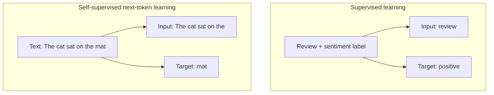
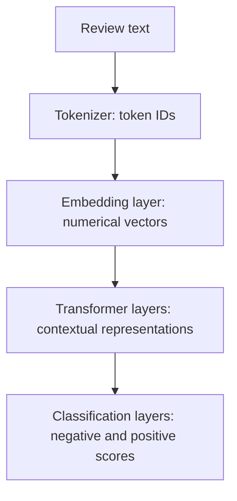
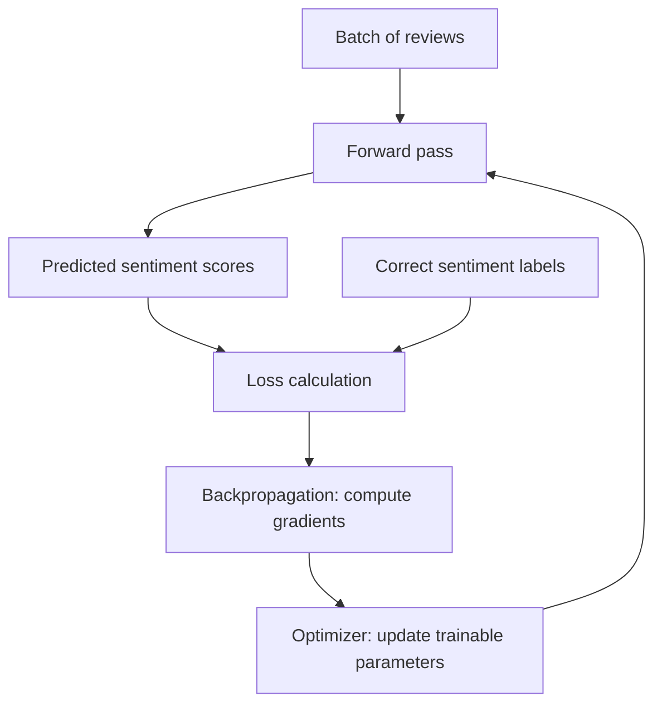

# Module 6 -- AI on HPC: Inference & Fine-Tuning

> **Time:** 2:00 to 3:00 PM CST · 60 min total · ~20 min lecture · ~40 min hands-on

## Learning Objectives

By the end of this module, you will be able to:

- Explain the difference between inference, pre-training, and fine-tuning
- Run inference with a pre-trained language model on the MI210 GPU and measure its throughput
- Fine-tune a text classification model using LoRA (parameter-efficient fine-tuning)
- Reason about GPU memory usage during inference and training
- Check an agent's change using the program's output and simple calculations

---

## Session Plan

| Part | Time | Focus |
|---|---:|---|
| Key Concepts | 20 min | Models and training; inference versus training; GPU batching; LoRA |
| Exercises 1 and 2 | 5 min | Check the environment and run the inference example |
| Exercise 3 | 8 min | Change inference settings and compare results |
| Exercise 4 | 12 min | Enable LoRA fine-tuning and examine the results |
| Agent Practice | 15 min | Add per-prompt token statistics and check the calculations |

The lecture covers concepts only. Code explanations appear beside the exercises
as lookup references, rather than additional lecture material. Challenges A
and B are optional extensions outside the planned 60 minutes.
Hands-on timings include editing, submission, and output review; queue delays and
agent response times can affect the pace.

---

## Key Concepts

### What is Machine Learning?

**Machine learning** uses data or experience to fit **models** that make
predictions, discover patterns, or guide decisions. A model maps inputs to
outputs. Training adjusts it based on examples or feedback, with the goal of
performing well on new inputs.

In **supervised learning**, examples include target outputs, or **labels**.
Our fine-tuning exercise uses reviews labeled positive or negative. In
**self-supervised learning**, targets come from the data itself. A text-generation
model can learn to predict the next **token**, a word or part of a word, using
the actual next token in existing text as its target.



These arrows show how an example supplies an input and a target. The target is
used to calculate loss, not given to the model as a clue for its prediction.
Many continuations can be valid: training learns probabilities, not a rule that
"the" must always be followed by "cat".

### Inference, Pre-training, and Fine-Tuning

**Inference** uses a trained model without updating its parameters.
**Pre-training** develops a base model, usually from a large dataset and
randomly initialized parameters. **Fine-tuning** continues training a pre-trained
model to adapt it to a task or behavior.

| | Inference | Pre-training | Fine-tuning |
|---|---|---|---|
| Purpose | Produce outputs | Develop a base model | Adapt a pre-trained model |
| Parameters updated | None | Typically all | All, or a selected subset |
| Data | Inputs to process | Training examples; targets may come from the text itself | Examples relevant to the task |
| Calculations | Forward passes | Forward passes, loss, backpropagation, optimizer updates | Same training steps as pre-training |

We use **two separate models**:

| Model | Use in this module |
|---|---|
| **TinyLlama 1.1B Chat**, about 1.1 billion parameters | Generate text. A decoder-only Transformer that extends a prompt one token at a time in this workflow. Its chat template adds the conversation markers it expects. |
| **DistilBERT**, about 67 million parameters | Classify IMDB reviews. An encoder-only Transformer that uses context from both directions. Its pre-training included masked-token prediction; the new classification layers start with random weights. |

Fine-tuning DistilBERT does not change TinyLlama. We train on 2,000 reviews and
evaluate on 500 separate reviews.

### Neural Networks and Training

A **neural network** has layers of mathematical operations with adjustable
**parameters**, including weights. Each layer transforms its input; layers
generally have their own parameters.

For our classifier, tokenization prepares the input. The neural network then
turns token IDs into sentiment scores:



This is a **forward pass**. Training adds loss calculation, backpropagation,
and an optimizer update:



- **Loss** measures the match between predictions and targets. For our
  classifier, it penalizes assigning low probability to the correct class.
- **Gradients** describe how small parameter changes would affect loss.
  Backpropagation calculates them; it does not change parameters.
- The **optimizer** uses gradients to update parameters. AdamW also maintains
  running statistics called **optimizer state**.

A **batch** groups examples for processing together. Here, one update follows
each batch of up to 32 reviews. An **epoch** is one pass through the training data.
Inference uses forward passes without the loss-driven parameter updates.

### Why GPUs for AI?

Neural networks use large matrix multiplications, containing many multiply-adds
that GPUs execute in parallel. Data movement matters too: our MI210 has 64 GB
of HBM2e and approximately 1.6 TB/s peak memory bandwidth.

Text generation uses forward passes in two phases:

| Phase | Work performed |
|---|---|
| **Prefill** | Process prompt positions together and save attention keys and values in a **KV cache**. The final prompt position supplies scores for selecting the first new token. |
| **Decode** | Process each newly selected token using the cache, extend the cache, and predict the following token. |

Calculations within a step run in parallel, but successive generated tokens
depend on previous ones. For one sequence, decode often reads much of the model's
weights to produce just one token, making memory bandwidth a common limit.

**Batching** processes several sequences together, reusing weights across them.
It can raise **aggregate tokens per second**, while requiring more memory.
Higher throughput does not necessarily mean a faster individual response.
The shared Qwen Code server uses **continuous batching**, adding requests and
removing completed ones as it runs.

### Parameter-Efficient Fine-Tuning: LoRA

Full fine-tuning updates every parameter. **LoRA (Low-Rank Adaptation)** freezes
the original model and adds small trainable updates to selected weight matrices.
Each update is the product of two smaller matrices; its **rank** controls their
size and the maximum rank of the update.

**Effective weight = frozen original weight + scaled low-rank update**

Our exercise adapts two matrices in each of DistilBERT's six transformer layers
and trains the new classification layers. Together, these are about **740,000
trainable parameters**, versus about **67 million** for full fine-tuning.
The exercise script shows the LoRA configuration and reports the exact counts.

| Memory component | Inference | LoRA training |
|---|---|---|
| Model weights | Required | Required, including frozen weights |
| Intermediate results and workspace | Required; generation also uses a KV cache | Required; saves activations needed for backpropagation |
| Gradients and optimizer state | Not needed | Needed for trainable parameters |

LoRA mainly saves gradient and optimizer-state memory. It still runs the model
forward and backpropagates through the operations needed to train the adapters.
**About 90 times fewer trainable parameters does not mean 90 times less total
memory or training time.**

---

## Hands-On Exercises

Suggested pacing: about 5 minutes for Exercises 1 and 2, 8 minutes for
Exercise 3, 12 minutes for Exercise 4, and 15 minutes for the Agent Practice.
The challenges are optional.

First, navigate to the exercises directory for this module:

```bash
cd module-06-ai-inference-finetuning/exercises
```

> **Important**
>
> All exercises run as **batch jobs** that produce output files. Submit your
> script, wait for it to complete, then examine the output while others use the
> nodes. Never run these models on the login node.

### Exercise 1: Meet the Shared Python Environment

The AI exercises use Python packages such as PyTorch (built for AMD GPUs with
ROCm), Hugging Face `transformers` and `datasets`, and `peft`. Together they
take 16 GB, so your instructors installed them once in a shared, read-only
Python environment (a **virtual environment**, or venv) that everyone uses.
Each batch script in this module activates it for you, and you already tested
it with the GPU check in Getting Started.

#### Step 1: Look Inside

On the login node, activate the environment and list a few of its packages:

```bash
source "${SC26_SHARED_DIR:-/work1/proj_sc26students/shared}/sc26_venv/bin/activate"
pip list 2>/dev/null | grep -iE '^(torch|transformers|datasets|peft) '
deactivate
```

> **Note**
>
> The shared environment is read-only, so `pip install` won't work in it.
> Everything the exercises need is already installed. If a script reports that
> the environment is missing, ask an instructor.

The models and the dataset these exercises use are pre-downloaded too, so your
jobs load them from a shared cache and never download anything. The way these
scripts load the dataset, the `datasets` library needs to write next to it,
and the shared copy is read-only, so the first fine-tuning job you run copies
the dataset (128 MB) into your `$WORK` directory.

---

### Exercise 2: Run Your First Inference

#### Step 1: Examine the Example

Look at the simple inference example:

```bash
cat ../examples/simple_inference.py
```

#### Step 2: Review the Inference Workflow

This script loads TinyLlama and generates responses to a few prompts. Examine
how it:
1. Loads the model and tokenizer, and moves the model to the GPU
2. Wraps each prompt in the chat template and tokenizes it
3. Runs a short, untimed warm-up generation
4. Generates output tokens, timing only `model.generate()`
5. Counts the tokens it actually generated and decodes them back to text

> **Note**
>
> PyTorch built for AMD GPUs (ROCm) still calls the GPU `"cuda"` and uses the
> `torch.cuda` functions, so the same code runs on AMD and NVIDIA GPUs.

GPU work runs in the background, so the script calls
`torch.cuda.synchronize()` before and after `model.generate()` to make sure the
timer covers all of the generation. It counts each response's tokens up to and
including the token that ends the response.

##### Understanding the Code: Generating Text with Hugging Face

The scripts already perform these steps; no additional edits are needed here.
The model is `TinyLlama/TinyLlama-1.1B-Chat-v1.0`.

| Call or value | What to recognize in the script |
|---|---|
| `AutoTokenizer.from_pretrained(name)` | Loads the tokenizer; `format_prompt()` applies its chat template |
| `AutoModelForCausalLM.from_pretrained(name)` | Loads the generation model |
| `model.to(device)` | Moves the model; input tensors must be on the same device |
| `input_ids`, `attention_mask` | Token IDs and a mask marking real tokens with 1 and padding with 0 |
| `model.eval()` with `torch.inference_mode()` | Evaluation behavior and disabled gradient tracking |

The central call is:

```python
outputs = model.generate(
    **inputs,
    max_new_tokens=64,
    do_sample=True,
    temperature=0.7,
    top_p=0.9,
    pad_token_id=tokenizer.eos_token_id,
    max_length=None,
)
```

| Setting | Meaning |
|---|---|
| `**inputs` | Pass the tokenizer's dictionary as named arguments |
| `max_new_tokens` | Maximum new tokens, excluding the prompt; an end-of-sequence token can stop generation sooner |
| `do_sample=True` | Sample tokens from the adjusted probabilities |
| `temperature` | Positive values below 1 concentrate probabilities; above 1 spread them more broadly |
| `top_p=0.9` | Sample from the smallest set of most likely tokens whose cumulative probability reaches at least 0.9 |
| `pad_token_id` | Here, use the end-of-sequence token ID for padding too |
| `max_length=None` | Leave the length limit to `max_new_tokens` in this call |

With `do_sample=False`, these scripts use **greedy decoding**: choose the
highest-scoring next token. Temperature and `top_p` then do not apply.

For this model, the output contains the input followed by the continuation.
The scripts remove the input before decoding the response. Generation timing
excludes loading, warm-up, tokenization, input transfers, and decoding.

**Output tokens per second = actual generated tokens ÷ generation time in seconds**

#### Step 3: Submit the Batch Job

```bash
sbatch submit_inference.sh
```

With no argument, `submit_inference.sh` runs this example. In Exercise 3,
you'll give it the name of your own script.

#### Step 4: Examine the Output

Check the output when it finishes:

```bash
cat inference_<JOBID>.out
```

**Questions:**
- How many tokens per second does the model generate?
- The script runs a warm-up generation before it starts timing. Why? (Think
  back to Module 5.)
- How much GPU memory is allocated after loading, and at the peak while
  generating? Besides the weights, what needs memory while generating?
- Do the generated responses make sense?

The scripts report memory **allocated** to PyTorch tensors. PyTorch's caching
allocator reserves somewhat more, and `rocm-smi` shows everything in use on the
GPU.

---

### Exercise 3: Experiment with Inference

#### Step 1: Open the Exercise

Open the inference exercise in an editor on the login node:

```bash
vim run_inference.py
```

In Vim, press `i` to enter insert mode and make your edits. Press `Esc`, type
`:wq`, and press `Enter` to save and exit. You can instead use `nano`, `emacs`,
or an existing VS Code Remote SSH connection.

#### Step 2: Change the Settings

The script runs as it is; its settings are working values for you to change
(see [Generating Text with Hugging Face](#understanding-the-code-generating-text-with-hugging-face)).
The script already runs on the GPU (`device = "cuda"`). There are **2 TODOs**,
plus an optional third:

1. **TODO 1**: Choose the response-length limit: change `max_new_tokens` to
   `64`. Longer limits take more time and can need more memory.
2. **TODO 2**: Choose the temperatures to compare: change `temperatures` to
   `[0.1, 0.7, 1.5]`.
3. **TODO 3** (optional): Add your own prompts to `PROMPTS`, and raise
   `NUM_PROMPTS` to include them.

The script uses the first `NUM_PROMPTS` of the prompts in `PROMPTS`. Here it
uses the first 2, so each run stays short.

#### Step 3: Submit the Batch Job

```bash
sbatch submit_inference.sh run_inference.py
```

When it finishes, check that the output says `Device: cuda` and names the GPU.

#### Step 4: Compare Temperatures

Your script runs every prompt at each temperature in `temperatures`, so one
job gives you a side-by-side comparison. In general:
- `0.1` concentrates the choice on the highest-scoring tokens, so responses
  are focused and can repeat themselves.
- `0.7` allows more variation.
- `1.5` flattens the choice, which often adds variation and mistakes.

A lower temperature doesn't make an answer more correct, and a model this
small can give weak answers at every temperature.

**Question:** Which temperature gives the most useful answers to your prompts?

---

### Exercise 4: Fine-Tune a Model with LoRA

Now let's adapt a pre-trained model to a new task. We'll fine-tune a text
classification model (DistilBERT) on the IMDB sentiment dataset using LoRA. The
code is already written; your task is to read and enable the three main parts.

#### Step 1: Open the Fine-Tuning Script

Open the script in an editor, as in Exercise 3:

```bash
vim finetune_lora.py
```

#### Step 2: Read and Enable the Three Code Blocks

Each TODO is a commented block between `BEGIN` and `END` markers. Read the
block, then remove exactly the first `#` from every line inside it. This keeps
the code's indentation and leaves its explanatory comments as comments. Leave
the marker lines unchanged.

> **Tip**
> 
> When using `vim` in editor mode, pressing `x` will delete the first character in front of the cursor. 

| TODO | What it enables | What to notice |
|---|---|---|
| **1: LoRA configuration** | Adds trainable adapters to the model | `r` is the adapter rank; `target_modules` selects the attention matrices to adapt. |
| **2: Training step** | Performs one parameter update for each batch | `backward()` computes gradients; `optimizer.step()` updates the trainable parameters. |
| **3: Evaluation** | Measures accuracy after fine-tuning | Evaluation makes predictions without updating parameters. |

After enabling each block, set its matching flag at the top of the file to
`True`: `LORA_CONFIG_READY`, `TRAINING_STEP_READY`, and `EVALUATION_READY`.
The job stops and names any task whose flag is still `False`.

#### Step 3: Predict, Then Submit

Before you submit, answer:
- Which parameters will LoRA train?
- Which call computes the gradients, and which call changes the trainable
  parameters?
- Why does training pass labels to the model, while evaluation compares the
  model's predictions with the labels afterward?

```bash
sbatch submit_finetune.sh
```

#### Step 4: Examine the Output

```bash
cat finetune_<JOBID>.out
```

> **Note**
>
> `finetune_<JOBID>.err` contains a "LOAD REPORT" that lists `MISSING`
> classifier weights and `UNEXPECTED` vocabulary weights. That's expected: the
> checkpoint was pre-trained to predict words, not classify reviews, so the
> classification layers are new, and training them is the point of this
> exercise.

Compare the output with your predictions:
- How many parameters are trainable compared with the full model? How many
  belong to the LoRA adapters versus other trainable layers?
- Does the training loss decrease over the three epochs?
- How does the final accuracy compare with the starting accuracy and the
  majority-class baseline?
- What was the peak allocated GPU memory? Which training memory components
  does LoRA reduce?

---

### Agent Practice: Report Per-Prompt Token Statistics

`max_new_tokens` is a limit, not a promise that every response will have that
length. Generation can stop sooner when the model produces an
end-of-sequence token. Your Exercise 3 script counts these tokens internally,
but reports only a total for each temperature. Have the agent add per-prompt
counts and a short summary, then check its arithmetic.

#### Step 1: Predict, Then Ask for the Change

Before using the agent, predict: will every response use all 128 allowed tokens?
What can make a response stop sooner?

Copy your completed script from Exercise 3. For this experiment, use all five
prompts and raise the limit so the model has a chance to finish some responses
before reaching it:

```bash
cp run_inference.py token_stats_agent.py
vim token_stats_agent.py
```

Make these two changes, then save and close the file:

- Change `NUM_PROMPTS` to `len(PROMPTS)`.
- Change `max_new_tokens` to `128`.

Check your settings:

```bash
grep -nE 'NUM_PROMPTS =|max_new_tokens =|temperatures =' token_stats_agent.py
```

The output should show all prompts, a 128-token limit, and the three
temperatures from Exercise 3. Then start Qwen Code:

```bash
bash ../../setup/launch_qwen.sh
```

Copy and paste this prompt:

```text
Update token_stats_agent.py to report the actual generated-token count for each prompt.

Reuse the existing count_generated_tokens() result. Do not tokenize the decoded response again.

For each temperature, print:
- each token count beside its response as: Generated tokens: N
- one summary line as: Token statistics: min=N, max=N, average=N.N, total=N

Preserve the existing throughput measurement. Do not change model.generate(), the prompts, temperatures, maximum token limit, model loading, shared cache, or Slurm workflow.
```

#### Step 2: Review Before You Approve

If the agent shows only part of the change, press `Ctrl+S` to see all of it.
The change should use ordinary Python data and calculations. Check that:

- It keeps the existing `n_tokens` value for each response instead of
  tokenizing the response text again.
- Each count stays paired with the prompt and response it describes.
- The minimum, maximum, average, and total come from those per-prompt counts.
- The `model.generate()` call and its settings are unchanged.

#### Step 3: Run It and Check

```bash
sbatch submit_inference.sh token_stats_agent.py
```

When the job finishes, inspect `inference_<JOBID>.out`. For every temperature,
check that:

- All five prompts have a generated-token count between 1 and 128.
- The reported total equals the five per-prompt counts added together.
- The average equals the total divided by 5.
- The minimum and maximum match the five displayed counts.
- The original generation time and tokens-per-second measurement are still
  present.

If a check fails, give the agent the relevant output and ask it to fix that
specific problem.

**Questions:**

- Did every response reach the 128-token limit? If not, what ended it?
- Did one temperature consistently produce longer responses in this small
  experiment?
- Why should the script count generated token IDs instead of words or
  characters in the decoded response?
- Type `/stats model` in Qwen Code. How many tokens did your agent session send
  and receive?

A completed version is in `solutions/token_stats_solution.py`.

---

### Challenge A (Optional): LoRA Hyperparameters

**Reference:** for a matrix with dimensions `d_out × d_in`, the adapter
has `r × d_in + d_out × r` parameters. Each adapted matrix here is `768 × 768`:
at rank 8, that is 12,288 parameters per adapter and 147,456 across all 12.
The classification parameter count does not depend on rank. Scaling both rank
and alpha together preserves `lora_alpha / r`, but need not preserve the actual
update magnitudes or training behavior.

Start with a prediction. In `finetune_lora.py`, change `r=8` and
`lora_alpha=16` to `r=16` and `lora_alpha=32`. Before you submit, predict the
output's parameter counts: the LoRA adapter parameters, the other trainable
(classification) parameters, and the total trainable parameters.

Then check your prediction. For this model and these target layers, you should
see 294,912 adapter parameters, twice as many as before, because `r` sets the
size of each adapter; the classification layers are unchanged at 592,130; and
the total is 887,042. `lora_alpha / r` is still 2. Note the training-loop time
and peak memory as well.

Then try other settings, changing one at a time and noting both `r` and
`lora_alpha` for each run:

- `r=4` vs. `r=64`
- `lora_alpha=16` vs. `lora_alpha=32`
- `NUM_EPOCHS=1` vs. `NUM_EPOCHS=3` vs. `NUM_EPOCHS=5`

LoRA scales its update by `lora_alpha / r`, so changing `r` alone also changes
that scale. A few runs are enough to see a pattern.

How do these settings affect the final accuracy? Does the training time change
with the rank? What might explain your result? A different seed could move the
accuracy by a point or two, so don't read too much into small differences.

### Challenge B (Optional): LoRA vs. Full Fine-Tuning

How much does LoRA actually save? Fine-tune the same model without it:

1. Copy your completed script, with all three blocks enabled and their flags
   set to `True`: `cp finetune_lora.py finetune_full.py`
2. In `finetune_full.py`, delete two things: the line
   `model = get_peft_model(model, lora_config)`, and the check that stops the
   job when no LoRA parameters are trainable (the `if lora_params == 0:` block).
   Every weight is then trained.
3. Submit it: `sbatch submit_finetune.sh finetune_full.py`

In the output, confirm that all 66,955,010 parameters are trainable (100%).
The count after wrapping now equals the original, because nothing was wrapped.

Compare the two runs: trainable parameters, peak allocated GPU memory during
training, training-loop time, and accuracy after fine-tuning.

Exercise 2's peak memory came from a different model (TinyLlama, 1.1 billion
parameters) with different inputs, so comparing it with these training peaks
isn't a controlled comparison of inference and training. What differs between
those runs, besides inference versus training?

Full fine-tuning often uses a smaller learning rate than adapter training.
Change `LEARNING_RATE` in `finetune_full.py` from `2e-4` to `2e-5` and run it
again. Does the smaller learning rate improve this run? (Hint: think about how
far each update moves the pre-trained weights.)

A full fine-tuning solution with the smaller learning rate is in
`solutions/finetune_full_solution.py`.

---

## Quick Reference

| Concept | Description |
|---------|-------------|
| **Inference** | Running a trained model on new inputs (forward pass only) |
| **Pre-training** | Learning a base model, typically from a large dataset |
| **Fine-tuning** | Further training a pre-trained model for a specific task |
| **LoRA** | Parameter-efficient fine-tuning that trains low-rank updates to frozen weights |
| **Tokenizer** | Converts text to and from the numerical tokens the model understands |
| **Temperature** | Controls randomness when sampling: lower is more focused, higher (>1) more varied. Must be above 0; to select the highest-scoring token instead, turn sampling off with `do_sample=False` (greedy decoding) |
| **Batching** | Generating for several prompts in the same steps, to raise total throughput |

| PyTorch / Hugging Face | Purpose |
|-----------------------|---------|
| `AutoModelForCausalLM.from_pretrained(name)` | Load a pre-trained text generation model |
| `AutoTokenizer.from_pretrained(name)` | Load the matching tokenizer |
| `model.to("cuda")` | Move a model to the GPU (`"cuda"` on AMD GPUs too) |
| `model.train()` / `model.eval()` | Select training or evaluation behavior (such as dropout on or off) |
| `torch.inference_mode()` | Turn off gradient tracking while evaluating or generating |
| `optimizer.zero_grad()`, `loss.backward()`, `optimizer.step()` | Clear gradients, compute gradients, update the trainable parameters |
| `model.generate(**inputs, ...)` | Generate text |
| `torch.cuda.synchronize()` | Wait for queued GPU work to finish, before reading a timer |
| `get_peft_model(model, lora_config)` | Wrap a model with LoRA adapters |

---

**Next up:** [Module 7 -- AI Agents & Capstone](../module-07-ai-agents/README.md)
